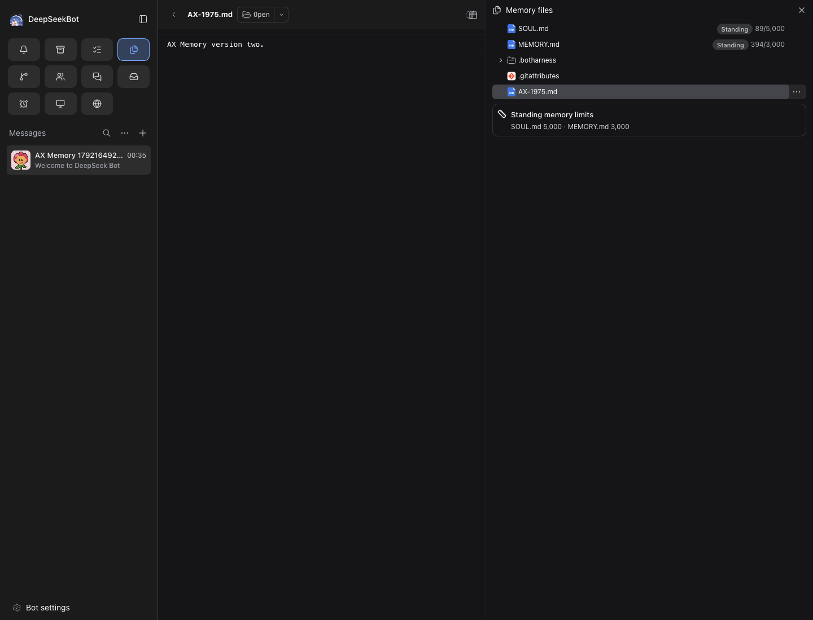
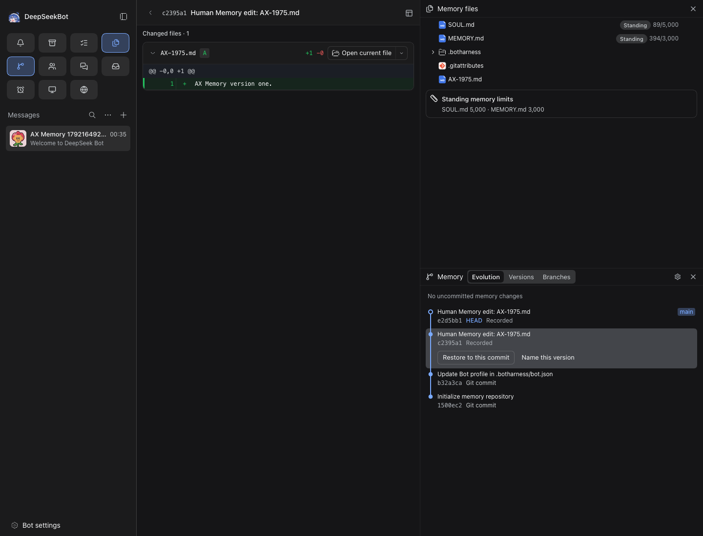
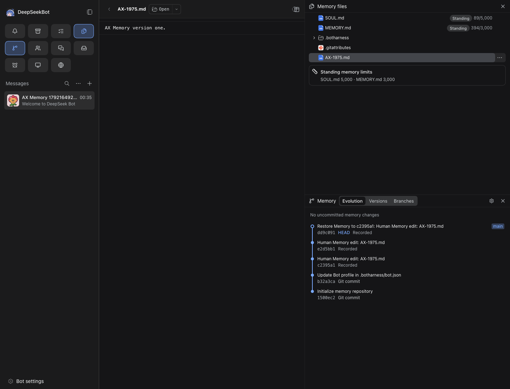

# #1975 Memory history and safe restore evidence

[PR #2003](https://github.com/BotHarness/DeepSeekBot/pull/2003) · source `871c739bc5263508a2773af49f6d53f381cb678b` · base `53b98377154eef2878bfbac975f9da9225222657`.

**Qualified:** one disposable PersonaBot, one file, two owner-saved versions, historical read, safe commit restore and stale expected-head refusal. The existing product owner and APIs are unchanged.

| Layer | Result |
| --- | --- |
| Local regressions | 147 evidence/report tests + 21 existing Memory CLI/UI tests passed |
| Local checks | lint, format, typecheck and clean-source build passed |
| CI | [Exact-head verify run](https://github.com/BotHarness/DeepSeekBot/actions/runs/38925220122); inspect its current conclusion separately |
| Real isolated Host | Pass, macOS arm64 / Node v24.21.0 / DSH 0.2.0-rc.2 / Chromium 153 |
| Agent visual inspection | Four screenshots/full ARIA inspected; pass receipt is hash-bound |
| Human QA | Not run; use the path below |
| Model, native devices, IM | Not run and not qualified |
| Cleanup | All six task Hosts stopped; test Profiles/Memory and evidence retained |

Bot `bot-747e4d7b05da482e962321024cef3d03`. File `AX-1975.md`.

| State | Memory HEAD | Content |
| --- | --- | --- |
| v1 | `c2395a1fb580dd454fe3b80526e462f7cf8e21fc` | AX Memory version one. |
| v2 before restore | `e2d5bb171503ba55b36169025a7bcc44c9f85c4b` | AX Memory version two. |
| restored | `dd9c091e5ef152182d4b4f768d3f662bde8de929` | AX Memory version one. |

The restored HEAD has v2 as its only parent; `backup` is null for this clean fixture. The saved checkpoint records v2. A subsequent request to restore v2 while expecting the obsolete v2 HEAD returns exit 1 / `memory-conflict`; both current content and restored HEAD remain unchanged. See [graph](verified/graph.json), [restore](verified/restored.json), [refusal](verified/refusal.json), [final read](verified/refused.json).

## Real visible states

Before restore: current version two.

Read historical version one; the diff's SHA is the target, while the graph HEAD remains v2.

After restore: current version one and the new descendant HEAD.

After stale-head refusal and a fresh Web reload: version one and the same restored HEAD.

[Independent coverage row](memory-row.md) · [full catalogue](coverage.md) · [machine report](report.json) · [visual receipt](verified/visual-review.json) · [evidence expiry controls](evidence-controls-reviewed.json).

The catalogue maps 13/133 E2E files (9.8%), with 19 feature documents. This is script mapping, not code/function coverage. Only the selected Memory row passes on this commit; other rows are not silently inherited.

## Retained failures

- [First attempt](historical-attempts/first/run.json): obsolete Memory-tab locator timed out; Host and Client healthy.
- [Second attempt](historical-attempts/second/run.json): historical row was exposed as a listitem named by full SHA, not a button.
- [Third attempt](historical-attempts/third/visual-review.json): CLI semantics passed but the Refresh click unexpectedly opened Panels; visual review rejected it. Final proof uses a fresh page reload. No underlying product fix is claimed.
- [Previous successful source](historical-attempts/final/run.json): source 9636c460, now historical and does not qualify the new source.
- [Review refresh failure](historical-attempts/review-fix/run.json): first-run onboarding blocked Bot selection; fixed by dismissing onboarding before selecting the existing DM channel.
- [Missing Git baseline control](provenance/context.json): CodeRabbit finding reproduced before fix; current runner retains blocked run/failure/coverage records when origin/main is unavailable.
- [Stopped Host control](stopped-host/run.json): blocked, with partial diagnostics. Missing image, stale commit and dirty source separately become needs-revalidation.

These attempts remain immutable historical records. They do not qualify the final source.

## Human verification path

Follow the [Memory feature recipe](https://github.com/BotHarness/DeepSeekBot/blob/871c739bc5263508a2773af49f6d53f381cb678b/.agents/skills/verify-deepseekbot/features/memory-restore.md). Build this clean source; launch a uniquely named isolated Host and run `scripts/e2e-memory-restore.mjs --name <name>`. Open the private launcher URL locally, select its new AX Memory Bot, and open Memory files / AX-1975.md and Memory evolution. Compare the file, both historical commits and the restore commit against that attempt's CLI outputs. Record Human feedback separately.

Stop only that instance's recorded PID and keep its Memory repository; do not run verify-app stop, which deletes the Profile. No remote push, credentials, branch switch, real Bot modification or Memory folder deletion is part of this recipe.

[Review explanation (Markdown)](pr-explainer.md) · [HTML download](pr-explainer.html) · [desktop preview](explainer-desktop.png) · [narrow preview](explainer-narrow.png). The explainer is not runtime evidence; GitHub may serve HTML as a download.

Task: `codex/local/01a1444a-0b96-7aa1-b677-220c4053cb4a`.
