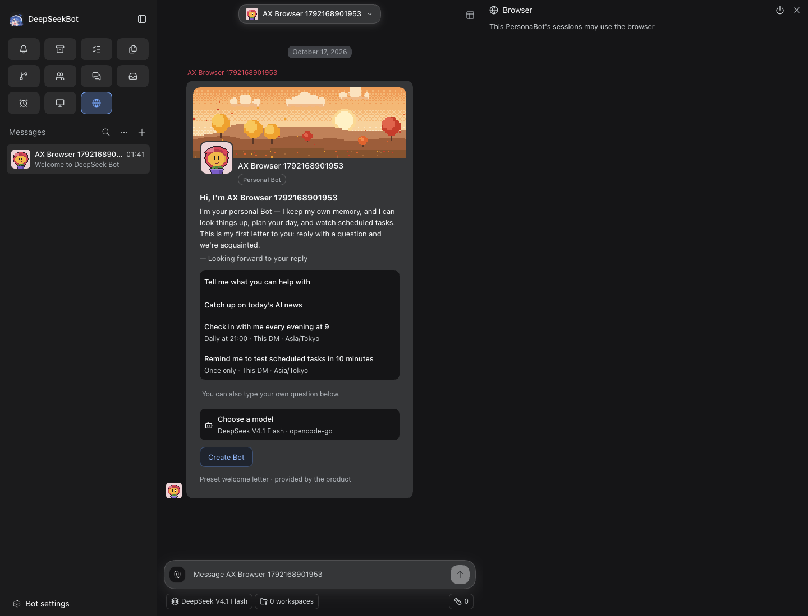
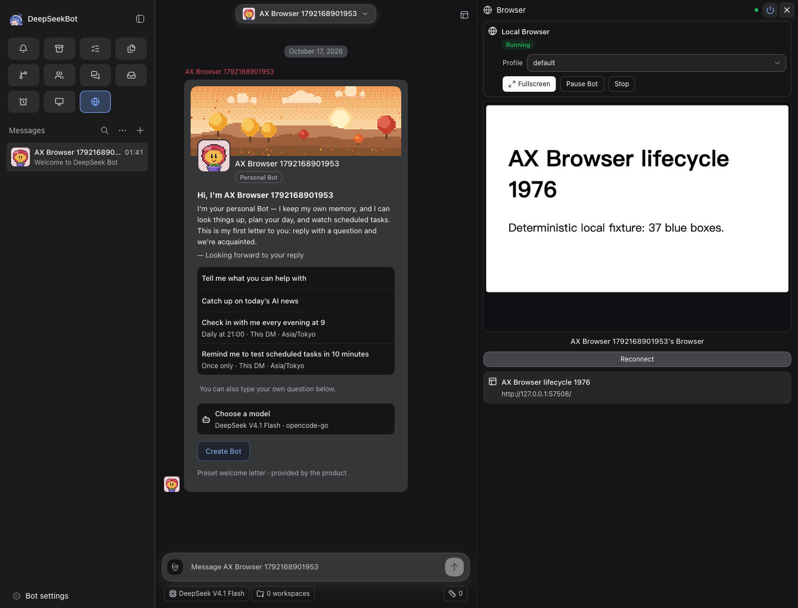
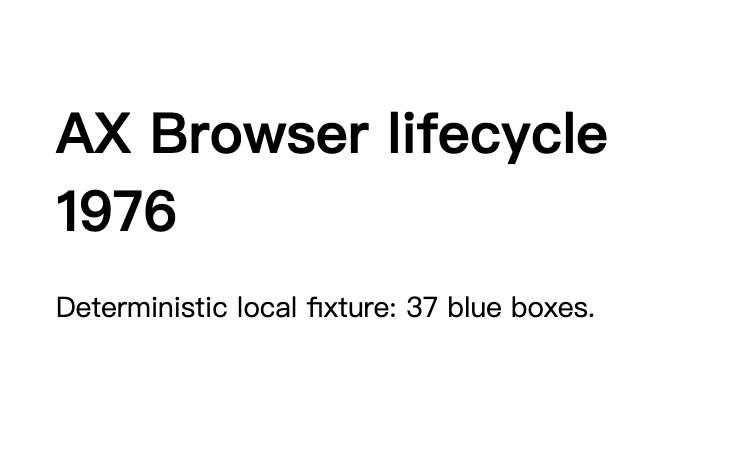
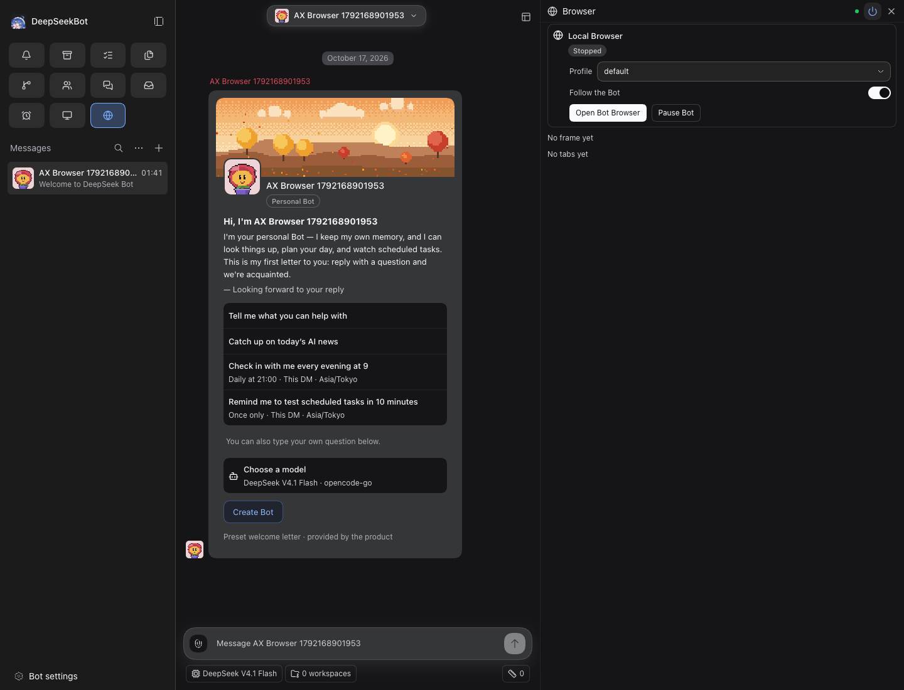
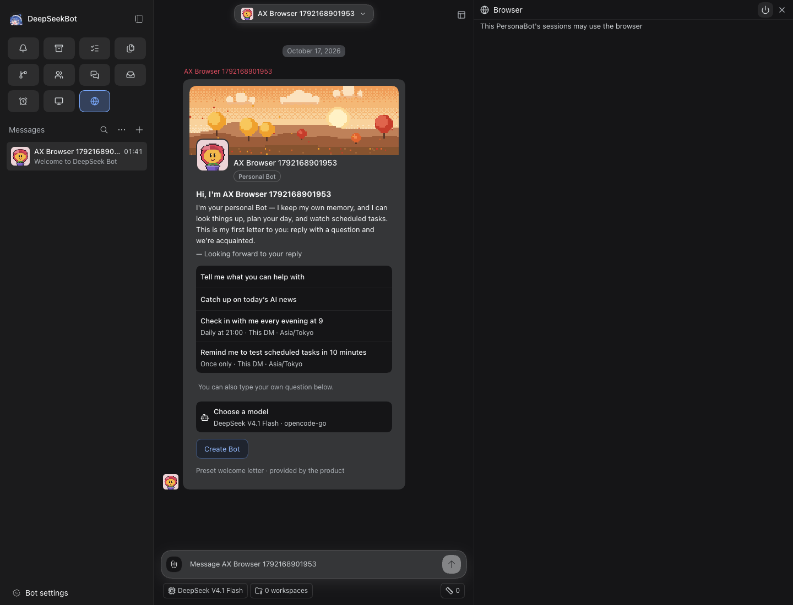

# #1976 Default Bot Browser lifecycle evidence

[PR #2008](https://github.com/BotHarness/DeepSeekBot/pull/2008) · source `fdf40ca64d3bca9092b24b8dbfe21f2fe1c060eb` · base `49ba9623ebf4de679ba518d8a67c5e2b1bf65dee`.

**Qualified:** one disposable PersonaBot, default Local Browser, one deterministic loopback fixture, real panel open/stop, direct tools and Browser observation, Access-off refusal. Product owners and APIs are unchanged.

| Layer | Result |
| --- | --- |
| Local focused regressions | 175 tests in 4 files passed |
| Static/build | lint, format, typecheck and clean-source build passed |
| CI | [Exact-head verify](https://github.com/BotHarness/DeepSeekBot/actions/runs/38934010734): success |
| Real isolated Host | Passed; macOS arm64, Node v24.21.0, DSH 0.2.0-rc.2, Chrome 153 |
| Agent visual inspection | Four Web screenshots/full ARIA and Browser frame inspected; hash-bound receipt |
| Human QA | Not run; recipe below |
| Model/native/IM | Not run and not qualified |
| Cleanup | Nine task Hosts stopped; Profiles/Memory and evidence retained |

Bot `bot-f4004be0787c4b8e9fadbc5821a499c3` · tab `7747665975A2C3F89554462262F3FB64` · fixture `http://127.0.0.1:57508/` · title **AX Browser lifecycle 1976**.
The fixture URL is correlation data from a terminated local server, not a reviewer service link. The panel, direct tab list, direct text read and actual frame agree. Panel Stop clears running, tabs, focus and frame. A subsequent direct observe refuses because no tab exists; Access-off direct open instead refuses because Browser Access is off. The default target remains Local and access stays off.

## Real visible states

Access off: permission explanation and disabled power control, not an enabled Browser's stopped card.

Running: local fixture title, text, URL and the Browser panel.

Authority's saved Browser frame:

After panel Stop: no running old tab, no frame and no tabs.

Access disabled after direct open refusal: unchanged permission state.

[Independent row](browser-row.md) · [catalogue](coverage.md) · [machine report](report.json) · [visual receipt](verified/visual-review.json) · [expiry controls](evidence-controls-review.json) · [lifecycle logs](verified/lifecycle.json).

Only `desktop.browser.open-observe-stop` is qualified. Full Browser lifecycle, multiple tabs, upload, profile reset/isolation, takeover and alternate Computer targets remain gaps. Script mapping statistics in the catalogue are not code or functionality coverage.

## Retained failures and controls

- [Exploratory shell failure](historical-attempts/discovery/browser-discovery.failure.png): generic Bot-mode shot used an English locator in a Chinese shell. The feature runner pins its language before navigation.
- [First](historical-attempts/first/run.json): Open entered fullscreen; panel Stop was obscured. The final runner uses Leave fullscreen. This attempt predates pre-cleanup Browser diagnostic capture and does not contain that evidence; its screenshots, ARIA, direct reads, Client diagnostics and cleanup are retained.
- [Second](historical-attempts/second/run.json): Access-off panel stabilizes on permission text, not a Stopped card. The final assertions distinguish these states. Pre-cleanup Browser state and logs are retained.
- [Third](historical-attempts/third/run.json): open/read/panel Stop succeeded, but a redundant Browser toggle closed the dock before the final screenshot. The final runner inspects the still-open panel. Logs and partial evidence retained.
- [Fourth](historical-attempts/final/run.json): direct lifecycle completed, but canonical disabled Access was omitted and the viewer retained an error banner. The final assertion follows the registry and requires the inline live-frame action and an empty viewer error; existing Reconnect is recorded when used.
- [Fifth](historical-attempts/reviewed/run.json): the inline viewer was incorrectly required to show the fullscreen-only Connected label. Reconnect is always offered in the inline footer; final validation checks the actual live-frame action and error area instead.
- [Pre-review success](historical-attempts/complete/run.json): retained for the earlier source; it does not qualify this revision.
- [Review-fix attempt](historical-attempts/crfix/run.json): semantic lifecycle completed before final cleanup changes; no visual receipt was issued for that superseded source.
- CodeRabbit findings fixed: Browser index row moved inside the table; redaction preserves longer fixture ports and removes the full login URL first. Port/token/early-failure regression tests passed. Initial lint failure from an added comment is retained in checks/lint-review-first.log; the final source removes it.
- [Stopped Host](stopped-host/run.json): real blocked precondition, not pass.
- Missing frame, changed source and dirty source become needs-revalidation; no selection is not-run.

Historical attempts never qualify this source. A local worktree path was removed from historical run action/coverage text for sharing; original local attempts are retained. The packet manifest hashes the exact shared bytes.

## Human verification path

Use the [manual Human QA steps](human-qa.md) or follow the [feature map](https://github.com/BotHarness/DeepSeekBot/blob/fdf40ca64d3bca9092b24b8dbfe21f2fe1c060eb/.agents/skills/verify-deepseekbot/features/browser-lifecycle.md). Build clean source, launch a uniquely named isolated Host and run `node scripts/e2e-browser-lifecycle.mjs --name <name>`. For manual interaction, open the private launcher URL locally, select the new Bot, close Sessions/Bot Inbox panels, open Browser, enable access and open the Browser. Leave fullscreen, use the existing direct browser_open command for the fixture created by the recipe, compare panel and CLI, then Stop and disable Access. The runner's fixture stops with the run; launch a fresh run to reproduce it. No external website or model is needed.

Inspect the saved screenshots and full ARIA plus authority outputs. Record Human feedback independently. Stop only the recorded task Host PID, retaining Profile/Memory; do not use verify-app stop, which deletes the Profile.

[Review explanation](pr-explainer.md) · [HTML download](pr-explainer.html) · [desktop preview](explainer-desktop.png) · [narrow preview](explainer-narrow.png). The explainer is not runtime proof.

Agent-Task: `codex/local/01a1444a-0b96-7aa1-b677-220c4053cb4a`.
