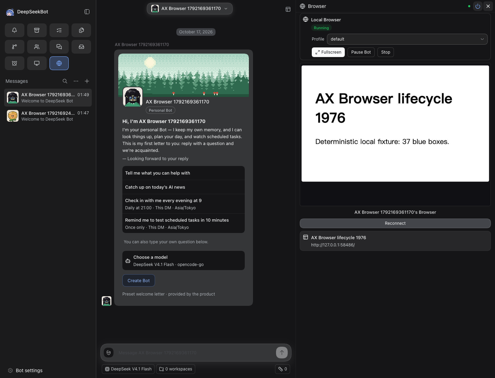
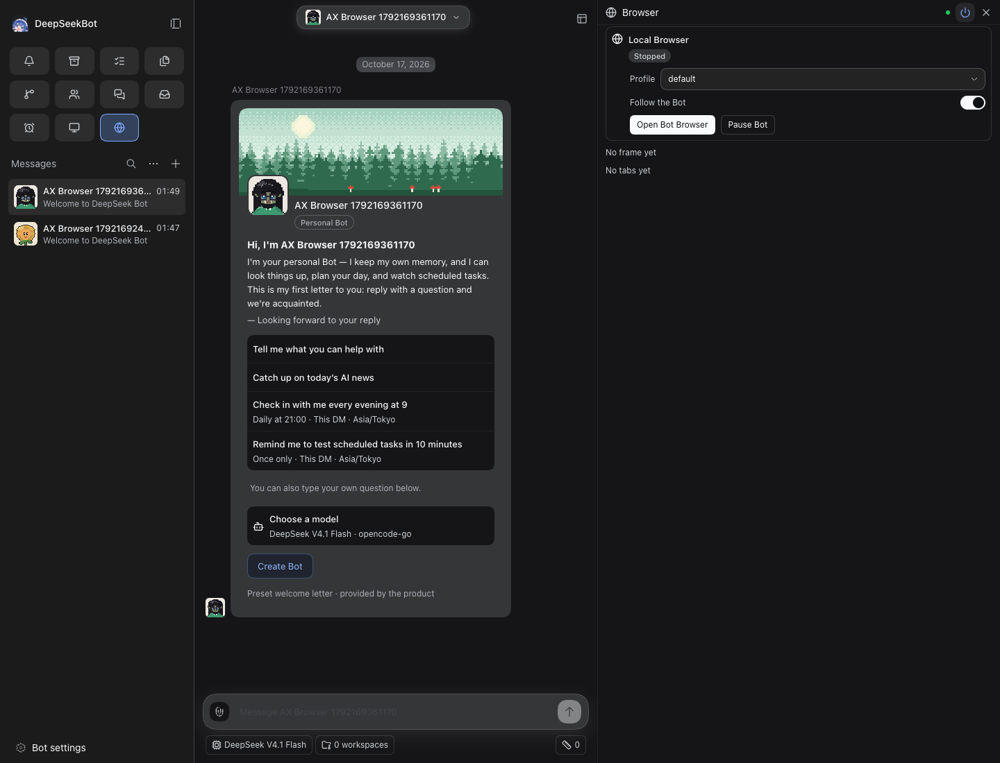
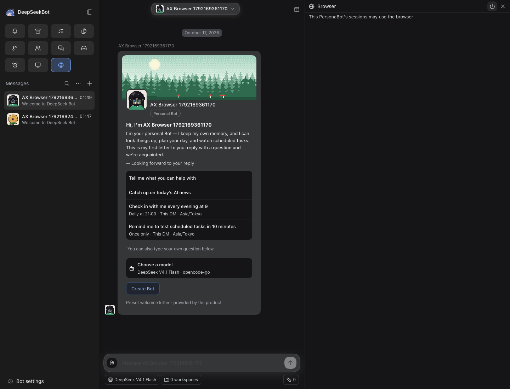

# #2008 merged-source integration verification

Source: `4116e181cfeba38938c698f55f1260994f9fa1f7`. This is the actual squash merge, including the concurrently merged Bot Session grouping change `6bef6edf0dfb84482ae94e6dd7a68a29b976fbfa`.

[PR #2008](https://github.com/BotHarness/DeepSeekBot/pull/2008) · [pre-merge review evidence and retained failures](https://github.com/BotHarness/DeepSeekBot/blob/45dc5df0cffbb1b23584b5fd390e539cdbbc7d9c/.github/pr-assets/1976-browser-lifecycle/README.md).

- Local: 175 focused tests in four files, lint, format, typecheck and build passed on this merge source.
- CI: [actual merge verify](https://github.com/BotHarness/DeepSeekBot/actions/runs/38934573427) passed, including all three test shards, static/build, docs and isolated Host smoke.
- Runtime: first attempt **FAIL**, second independent attempt **PASS** on the same source and task Host. The first attempt recorded a startup frame HTTP 404 and used Reconnect before the fixture became visible. The retained failure is not superseded by the retry; startup reliability remains a finding. See [first failure](first-failure/run.json), [console](first-failure/console.json), [HTTP](first-failure/http-errors.json), and [failed coverage row](first-failure-row.md). The successful retry used disposable Bot `bot-283e7c7922494d779a8ca2b8965b66a5`, default Local Browser and one deterministic loopback fixture. Real panel open/stop, direct tools and Browser authority agree; stop clears tabs/frame and Access-off refuses distinctly.
- Agent visual: four screenshots/full ARIA and actual Browser frame inspected, matching [hash-bound receipt](verified/visual-review.json). Console and HTTP-error logs are empty only in the successful retry; the first run retains its startup 404. Lifecycle and Client diagnostics retained.
- [Evidence expiry controls](evidence-controls-merged.json): pass only for this source; missing image/stale/dirty source require revalidation, unselected run is not-run.
- Cleanup: task-owned Host/Browser/fixture stopped. Profile/Memory retained. This adds one stopped Host to the nine documented in the earlier packet.
- Human QA, model, native devices and IM: not run. Broader Browser lifecycle remains unqualified. [Manual Human path](https://github.com/BotHarness/DeepSeekBot/blob/45dc5df0cffbb1b23584b5fd390e539cdbbc7d9c/.github/pr-assets/1976-browser-lifecycle/human-qa.md).

[Independent behavior row](browser-row.md) · [same Bot/tab](verified/running.json) · [direct text](verified/direct-read.json) · [lifecycle diagnostics](verified/lifecycle.json).

The loopback fixture URL is historical correlation data; its server is stopped. No shared service, model behavior or production receiver was changed. A startup timing hypothesis is suggested by the frame route checking runtime/current-tab/frame availability; the exact cause has not been isolated and is not attributed to the concurrent Session grouping change.

Agent-Task: `codex/local/01a1444a-0b96-7aa1-b677-220c4053cb4a`.

Intermittent startup finding: [#2012](https://github.com/BotHarness/DeepSeekBot/issues/2012). The first failure remains failed; the retry pass does not close this finding.
