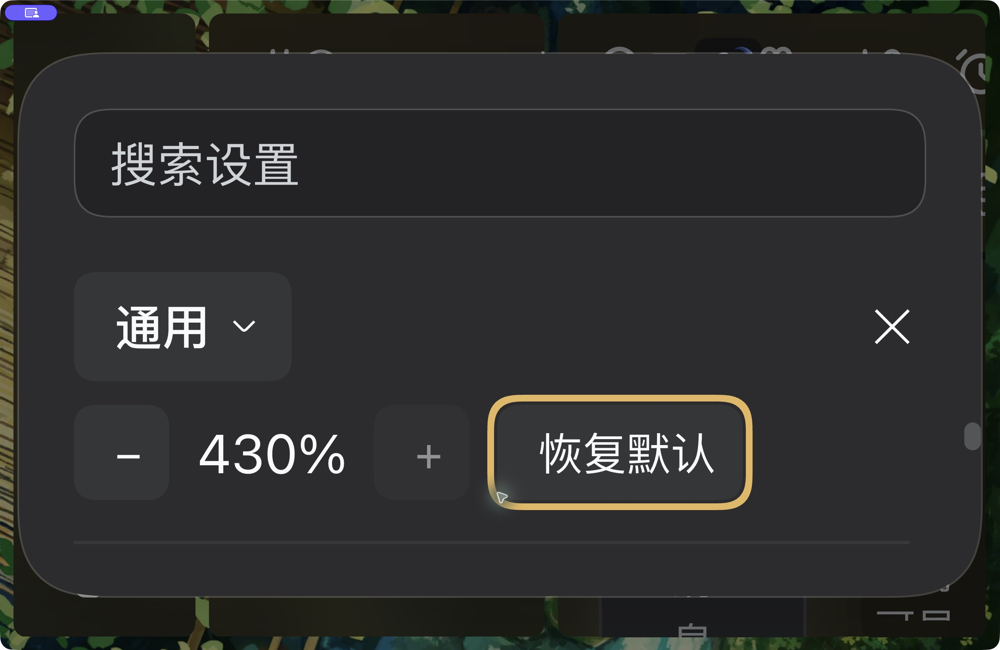
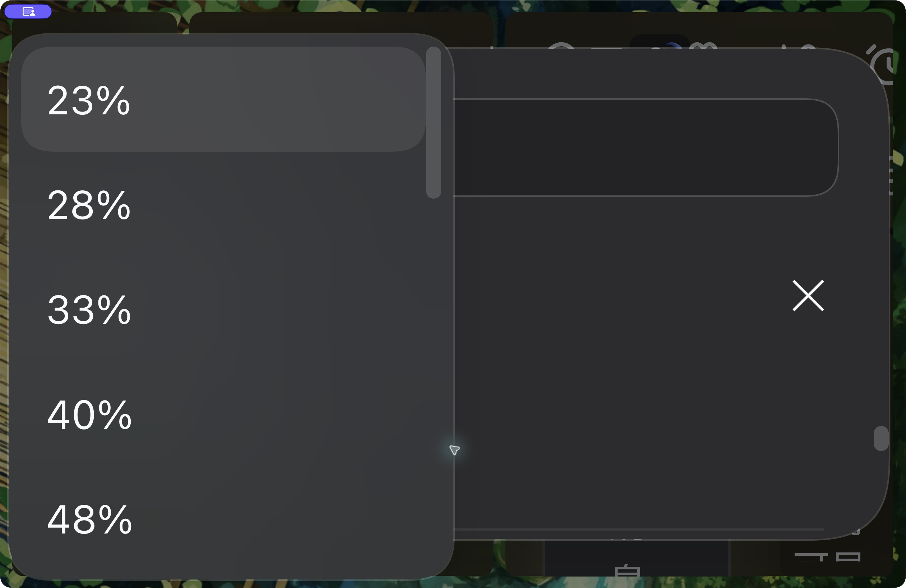
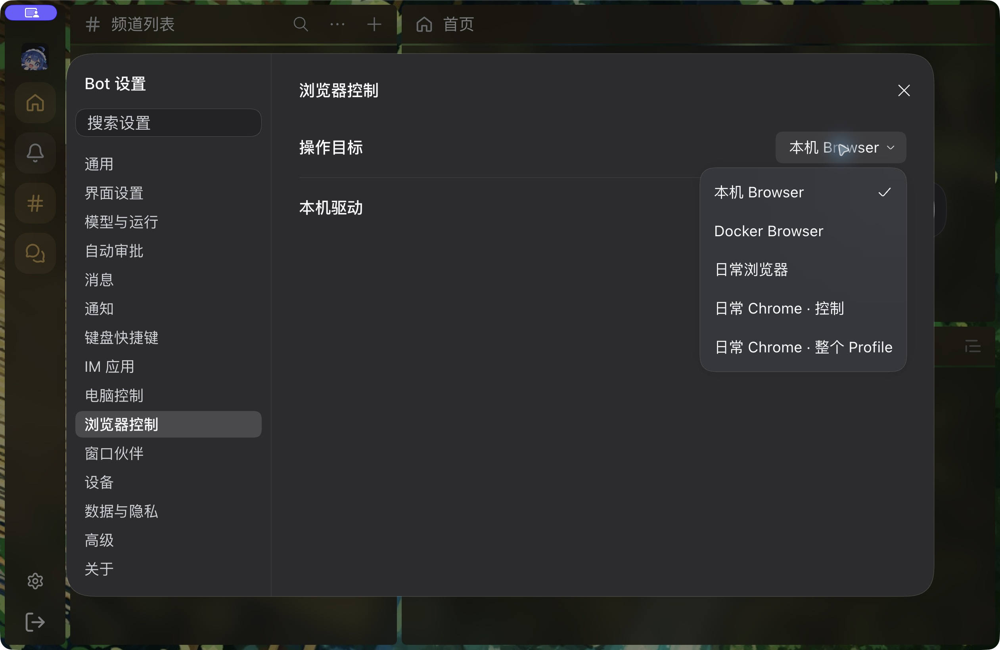

# Shared Select zoom regression

Source commit: `f12c5e658a79655090d9e0d3b08fc880b4a86012`. Both images use the same 1261×820 viewport, 144% CSS zoom and synthetic fixture state. They show the production Select/SettingsDialog/PointerMenu and unmodified reachable DSH Menu/Modal code and CSS. This is an isolated source-component fixture, not a running DSH/native-window screenshot.

- Before: the native body-portaled choice menu is outside the viewport.
- After: the menu is aligned with the trigger inside its owning Settings Modal.
- Baseline: 132/136 cases fail across 17 levels, two viewport sizes, start/end alignment and page/dialog containers.
- Fix: 136/136 pass with no page errors. Keyboard selection, menu-only Escape, focus return, toggle/outside dismissal, retained draft/menu identity and open-menu zoom changes are also asserted.
- 2035 Client tests pass (one existing skipped test); 29 related tests, lint, formatting, root/mobile types and a production Client build to a separate temporary output pass.

Run `node scripts/check-select-zoom.mjs --output <report.json>`; add `--baseline e17154081` to reproduce the failure and `--screenshots <directory>` for the matched images. The fixture blocks requests outside its own loopback origin and uses no Host, credentials, user wallpaper, messages or guest browser.

## Native follow-up — 2026-10-19

The [native menu probe](native-menu-probe.json) records actual installed Desktop checks at
144%, 23% and 430%. At maximum zoom, keyboard focus scrolls the recovery button into view;
the default picker stays inside the viewport and can select the minimum level. These three
captures are actual Desktop output from the .12 artifact, with its version stated explicitly.
They are additional evidence, not a relabeling of the source fixture before/after pair.

The final .14 artifact passed closed-app enable/restart, original font preservation, A→B→A
local Host switch and exact-target CLI read/set/reset. The Human accepted final wallpaper,
header/corner, panels and zoom Settings in native windowed/fullscreen modes. Real IME was
explicitly accepted earlier in this task. Current full Client regression passes 2035 tests
with one existing skip; Browser 407/8skip and Computer/selected workspace 234/3skip passed.

Fresh embedded automation did not establish guest focus: a nested AX click left the real
parent focus on Bot Settings, so its root zoom event is excluded from webview proof. The
fixture was disposed, and prior Human guest foreground/once-only records retain their own
scope. Remaining final native focus/popup qualification keeps #2269 open and PR Draft.
No new PR has been merged or released.

## Final-package focused embedded and popup follow-up

The Human foregrounded the same existing Desktop. The [final native embedding record](final-native-embedding.json)
now establishes real guest input focus, same guest identity/navigation/input, one minus and
one plus whole-window action, and unchanged guest-native zoom. Focused same-origin and
cross-origin iframes plus the main input were also driven through CUA native keys, with
per-document readback. Equal delivery may include Shift; it is not relabeled physical plain Equal.

The earlier failed nested-AX attempt is retained above. The new accepted guest rows explicitly
have parent WEBVIEW focus and guest `hasFocus=true`. The task fixture was removed through its
owned release, leaving the same formal window at144%. No production guest recovery hack exists.

Final .14 Browser/Computer target menus and Home context-menu screenshots additionally show
correct viewport placement and native Escape/focus return. No target, permission or message was changed.

Remaining: broader native tooltip/fixed-geometry occlude/minimize/restoration on the final artifact.
Tool Minimize actions did not establish hidden state, so they are not counted as a pass. The
late console cohort also has three native `/plugins/events` network failures; no whole-cohort
error-free claim is made. #2269 remains open, and prior Human webview-restoration proof keeps
its original scope. Windows/Linux remain deferred.
