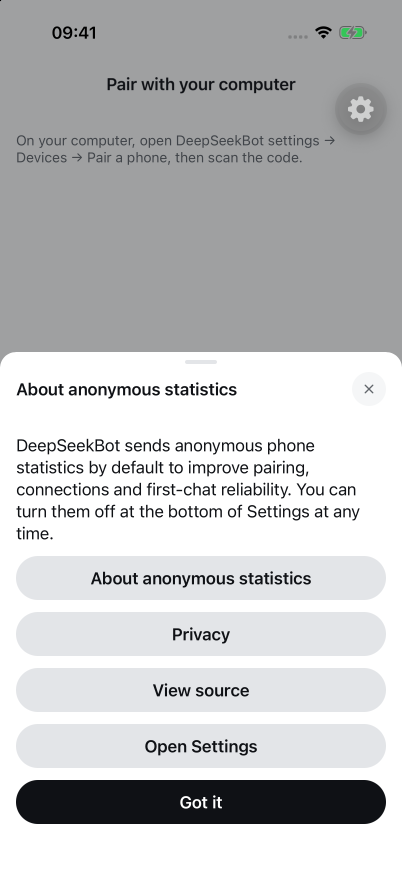
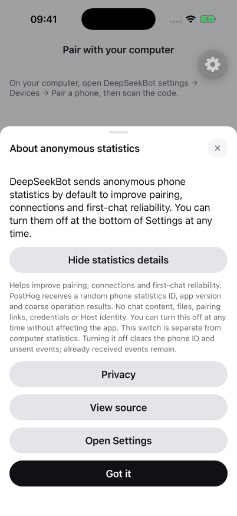
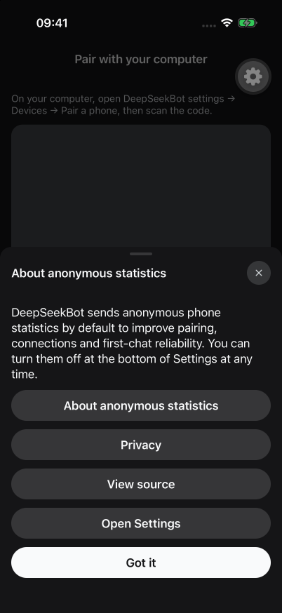
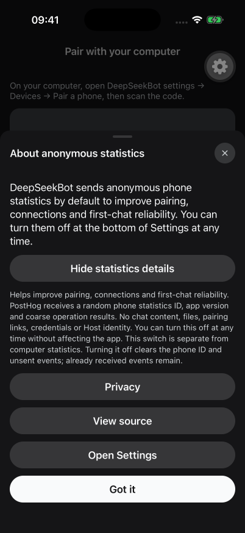
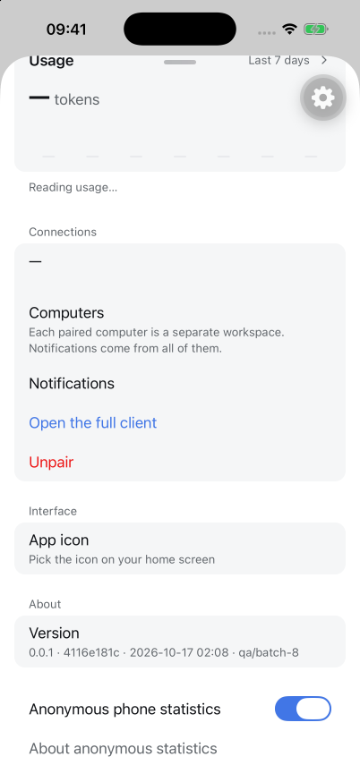
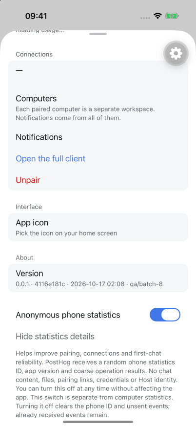
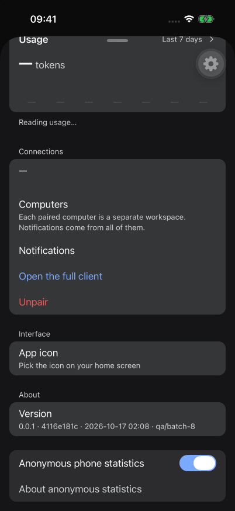
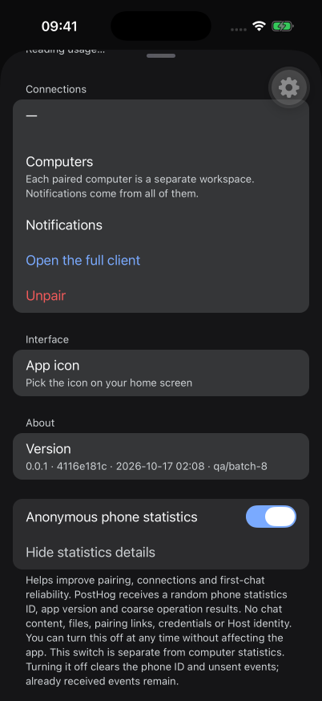

# #1944 — Batch 8 native iOS acceptance

**Result: PARTIAL / NOT ACCEPTED AS ALL GREEN.** Tested on 2026-10-17 JST after the #2007 runner released the shared Simulator. Two reproducible UI problems and one Simulator font limitation remain. No product source changes made in this QA run.

## Exact source and build

- PR source: `e3a9798a0d8c3e5ac5b72d9fa63216ae6142b8a9`; merged as `2ece14014654f83cdd94f9e3f2e01150c4f19cb2` on 2026-10-16. [CI](https://github.com/BotHarness/DeepSeekBot/actions/runs/38804869486): lint/format/types/build, three test shards, docs and isolated Host smoke passed; real-model scenarios skipped.
- Native source: frozen main `4116e181cfeba38938c698f55f1260994f9fa1f7`, local-only `qa/batch-8`. This includes merged #1944; **does not include open Draft #2007**. Finishing that runner's window is not merging its typography changes.
- Fresh SDK 57 development build, iOS 26 Simulator / iPhone 17 Pro / portrait 402×874 logical pixels; app 0.0.1 (1). `expo-device` 57.0.2 and `expo-application` 57.0.3 included. Native build succeeded, followed by normal Xcode local simulator signing.
- Real native screenshots, not Web fixtures. Manual focused journeys; the standard e2e script was deliberately not run because it erases the shared Simulator.

## Results

| Case | Result | Evidence / qualification |
| --- | --- | --- |
| Fresh preference defaults ON | PASS | Native first-use notice and Settings switch; stored `enabled=true`, `noticeSeen=false`, identity present, empty queue. Original statistics file was absent. |
| Explanation collapsed initially, expands/collapses | PASS, EN default size | Notice and bottom Settings section; light and dark screenshots. |
| Statistics switch at very bottom | PASS | Below the About/Version section; screenshots show all preceding sections. |
| Notice Open Settings | PASS | Actual native modal dismissal and Settings presentation in EN and ZH. |
| Disable persists and removes local ID | PASS, storage | Stored `enabled=false`, identity absent, queue empty. Queue was already empty; clearing a non-empty native queue was not tested. |
| Disable survives process restart | PASS | Stored false; restarted UI visibly OFF; notice does not reappear. |
| Re-enable persists, does not repeat notice | PASS, storage/restart | Stored true with identity, noticeSeen stays true; restart did not show notice. New-identity inequality was not inspected. |
| Toggle immediate visual state | **FAIL** | After pressing ON→OFF, storage becomes false but switch remains visibly ON. Reproduced twice, including after >10 seconds; direct simctl screenshot agrees with agent-device screenshot. On restart the UI becomes OFF. OFF→ON similarly persisted true while the current control stayed visually OFF. |
| Auxiliary large text | **FAIL / partial** | Changing `large`→`accessibility-medium` while Settings is open clips rows vertically. After process restart row heights recover, but statistics title and details entry truncate. Notice header/details entry also truncate. Explanation can expand and scroll; Open Settings works. This source does not contain #2007's proposed typography fixes. |
| Chinese rendering | **BLOCKED / visual failure** | AX has full correct Chinese labels, but pixels omit CJK text or show boxes. Also reproduced in iOS Open confirmation and Safari, so it is not attributed solely to #1944. Persists after signing repair. Chinese light captured; further Chinese dark matrix stopped because baseline is unreadable. |
| Privacy / source link | PARTIAL | Taps dispatched; Privacy opened Safari, redirect host displayed `deepseekbot.app`. Safari first-run UI and missing fonts prevent page-content acceptance. Source button tap executed; destination page was not qualified. |

## Reproduction and evidence

1. Default size, fresh launch; tap **Open Settings**, scroll to bottom. See [light](settings-en-light.png) / [dark](settings-en-dark.png).
2. Tap the blue statistics switch once. Safe on-disk summary is `{ "enabled": false, "noticeSeen": true, "hasIdentity": false, "queueCount": 0 }` but [settled native UI remains ON](toggle-after-off-settled.png). Restart app and return to Settings: [switch is OFF](settings-disabled-restart.png). This is an immediate UI state bug, not evidence of continued transmission.
3. While Settings is open, change system content size to accessibility-medium: [rows clip](settings-large-text.png). Restart and scroll to bottom: [statistics labels truncate](settings-large-text-restart-bottom.png). [Expanded explanation](settings-large-text-expanded.png) scrolls.
4. Chinese locale: [native screenshot after signing repair](notice-zh-after-signing.png). AX text is not a substitute for readable pixels.

| Notice collapsed | Notice expanded |
| --- | --- |
|  |  |
|  |  |

| Settings collapsed | Settings expanded |
| --- | --- |
|  |  |
|  |  |

## Environment recovery and preservation

Only idle regenerable native build/project caches and idle phone compiler intermediates/module cache were removed. Compiled phone app, source, evidence, Simulator data, original Host and pending approvals were retained. Initial free disk 12.1 GiB → 16.8 GiB after the first cleanup. Later download/build/system/concurrent activity makes later changes non-attributable to this task. Final measurement approximately 12 GiB free; shared build 3.4 GiB. Next runner must refresh disk inventory before rebuilding (below the ~15 GiB start floor).

First build lost its active build database/Products; cause unknown, log retained locally. Protected retry succeeded. Unresponsive Simulator service recovered by targeted restart/reboot of the existing device, no erase. Initial manually signed package raised an expo-notifications Keychain entitlement error; normal Xcode simulator signing rebuilt/reinstalled the same bundle and the error did not recur in subsequent launches. These are environment recovery events, not clean-first-attempt build evidence.

No Host restart, reseed, unpair action or approval action. Original Host listener stayed on its original process. Existing app/container and keychain were not erased. This rebuilt client showed the pairing screen; retained-pairing usability was not requalified. Only this task's newly created statistics preference was removed afterward, restoring its original absence. Simulator restored to light/default `large` text. Unrelated untracked documents retained. Task Metro and device session released after capture.

## Limits and next action

No telemetry collection target/token configured, so no real PostHog receipt, production collection, or network opt-out assertion. No physical iPhone, Android, VoiceOver, model response, paired-Host integration or production privacy-publication acceptance. Source CI is not native or Human QA.

Fix/retest the immediate switch visual state on the current source. Recheck large text when #2007 is integrated, including statistics title/details and live size changes. Recover Simulator CJK fonts before Chinese visual acceptance. Do not treat this report as all-green acceptance.
