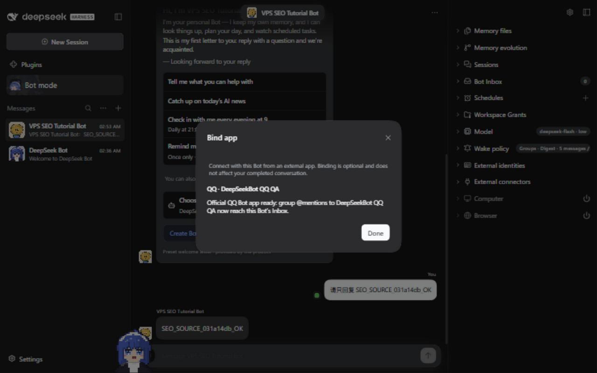

# 在 worktree 之间复用 QQ QA 客户端

为 QA1、QA2、QA3 各分配一个独立的官方 QQ Bot 应用。切换分支时复用该槽位的专用 DSH_HOME，原生 Provider 授权继续保留在同一个 Profile 中。槽位可以是本机或远程接收器。机器本地注册表只记录元数据，凭据保留在原生 Credentials Service。已有 QQ 授权可以只复用选中应用的凭据，初始化另一个专用 Profile，无需复制整份凭据存储。

## 登记已有应用

从包含脚本的任意 checkout，为每个独立应用登记一次：

```bash
node scripts/dev-qq-test-clients.mjs register QA1 \
  --name 'Example QQ QA 1' --app-id 100001 --group 123456789
node scripts/dev-qq-test-clients.mjs register QA2 \
  --name 'Example QQ QA 2' --app-id 100002 --group 123456789
node scripts/dev-qq-test-clients.mjs list
```

这些值是示例。暂时不知道 AppID 时，省略 `--app-id`，随后在原生 IM 设置中核对真实应用。名称不能证明应用身份。不传 `--home` 时，本机槽位各自使用 `~/.dsh-botharness-qq-qa<n>` 和 `web-dev` Profile；可用 `--home`、`--profile` 指定。任务专用 VPS Unit 还应传入 `--remote`，脚本会拒绝在本机启动该接收器。

元数据存放在 `~/.config/botharness/qq-test-clients.json`，沿用 [Lark 测试应用](im-test-apps.md) 的私密文件保护机制。`BOTHARNESS_QQ_TEST_CLIENTS_FILE` 可指定共享文件。Windows 与 WSL 默认使用各自的 HOME。`list` 显示槽位名称和认领信息，不显示 AppID、群号或凭据；认领信息含本机 worktree 路径，请勿公开输出。

## 认领并启动本机客户端

先与 Human 核对，并检查所有可能接收该应用的机器上的进程或 Unit。本机注册表无法发现另一台机器独立运行的接收器。然后在具名 Issue 分支中执行：

```bash
node scripts/dev-qq-test-clients.mjs claim QA1 \
  --task codex/local/<task-id> --receiver my-task-host --confirmed-idle
node scripts/dev-qq-test-clients.mjs launch QA1 \
  --task codex/local/<task-id> --port 31971
```

存在 `CODEX_THREAD_ID` 时，`--task` 默认是 `codex/local/$CODEX_THREAD_ID`。认领记录任务、分支和 worktree；其它任务不能接管槽位或替换其元数据。认领不会自动过期。写锁避免同时修改注册表；进程崩溃留下的锁必须先检查，再人工恢复。

启动沿用 `dev-instance.mjs`，使用槽位的 HOME/Profile、当前 worktree 和 qualified IM Provider。先构建当前分支，并使用[固定版本的本机开发工具链](../client-bridge.md)。启动器会输出私密登录 URL，不要公开录制该输出。它不会停止已有 Host。发现 Profile 写入者记录或重复启动请求时，会在启动第二个 Host 前拒绝。启动结果不确定时，检查该 HOME、端口和准确 PID；槽位继续保持认领。

空白 Profile 没有可复用的授权时，打开 **Settings → IM bots → QQ → Manual setup**，由 Human 在原生表单直接输入已有应用的 AppID 和 AppSecret，录制保持停止。合格 Provider 的 **Scan QR code** 流程会创建并连接 Bot，只在确实需要新建应用时使用。已有停止运行的原生 Profile 授权时，使用下方 CLI 流程，无需重复输入 Secret。核对已认证的应用身份，再通过目标 PersonaBot 的 **External identities** 绑定。原生授权和 BotHarness Binding 是两步，注册表认领不提供其中任何一种权限。分支的数据 schema 不兼容时，应使用兼容程序或另建 Profile，不要用不兼容程序打开旧数据。

登记时省略 AppID 的，在核对已授权 Provider 的身份后补记：

```bash
node scripts/dev-qq-test-clients.mjs identify QA1 \
  --task codex/local/<task-id> --app-id <verified-app-id>
```

只有认领任务、worktree 和分支可以补记。此操作记录已检查的元数据，不执行应用认证。替换已知身份、或使用另一个槽位已登记的 AppID，都会拒绝。

## 用 CLI 复用选中的原生授权

这是开发脚本，调用合格 Provider 的原生管理端点，并非已发布的 `deepseekbot im-authorize qq` 命令。当前实测 Provider revision 为 `602baa37fa327f7069545aaadbbd34db8a8f4636`，DSH 为 `0.2.0-rc.1`；其它 Provider 需要单独验证契约。

检查选中来源 Profile 的准确接收器，确认它在所有机器上均已停止。在认领分支中连接本机目标 Host：

```bash
node scripts/dev-qq-test-clients.mjs connect QA1 \
  --task codex/local/<task-id> --port 31971 \
  --token-file <claimed-home>/owner-token \
  --source-home <stopped-authorized-home> --confirmed-source-idle
node scripts/dev-qq-test-clients.mjs status QA1 \
  --task codex/local/<task-id> --port 31971 \
  --token-file <claimed-home>/owner-token
```

脚本核对登记 AppID、来源原生 QQ 配置和派生凭据引用，只读取该应用的 Secret，再通过 loopback 上经过 Owner 认证的 `/api/dsh-im/qq` 调用 `bot.bind-credentials`。Provider 自己写入原生 Credentials 和配置。Secret 不进入 argv、注册表或输出。来源 Profile 保持只读，无关凭据和 Binding 不复制。目标已有相同应用时只检查，不替换授权；目标含其它应用时拒绝。

远程槽位的两个命令均追加 `--ssh-config <private-json> --remote-node /absolute/path/to/node`。私密文件不得提交：

```json
{
  "host": "example-host",
  "user": "example-user",
  "identityFile": "/private/example-key",
  "knownHostsFile": "/private/verified-known-hosts"
}
```

创建 `knownHostsFile` 前独立核对 SSH Host key。脚本强制严格 Host key 校验、专用身份和 batch mode；选中的 Secret 只经 SSH stdin 传输，Owner 登录和 Provider 调用在远程 loopback 完成。token 文件必须位于认领 HOME 内。远程脚本不会停止或重启 Unit。连接失败或被中断时继续保留认领，拒绝盲目重试：先检查 `status` 和准确接收器，需要再次尝试时明确停止并交接。

后续分支使用同一 Profile 时，旧接收器停止后认领、启动，再执行 `status`，无需重复 `connect`，也无需重新输入授权。`connected: true` 证明传输就绪，不证明群内渲染。新 Ubuntu 26.04 VPS 已用此路径实际连接已有 QA 应用，未再次输入 Secret；原 QQ 群聊天验收仍是独立检查。



_CLI 连接后的真实原生 Web 截图，2026-10-11 18:11 UTC。绑定通过 External identities 完成；此画面不证明 QQ 群内回复。_

## 停止与交接

只停止该认领标明的准确 Host/接收器。确认进程退出、监听及接收停止，远程 VPS 也需检查，然后执行：

```bash
node scripts/dev-qq-test-clients.mjs release QA1 \
  --task codex/local/<task-id> --confirmed-stopped
```

释放要求任务和 worktree 与认领一致，并保留 Profile、授权和历史。下一个分支重新核对接收器后再认领。注册表协调本机合作任务，不构成分布式接收租约，也不会停止另一个 session 的 Unit。

真实聊天验收要求在指定 QQ 群发送新的、带唯一标记的 @mention，观察原群实际回复，并关联 Source Event、Inbox Admission 和 Outbox 证据。Host 重启后用新 mention 重复验收。Provider accepted 和重启前的来源证明不能替代此结果。详见 [QQ 连接指南](../qq-connection.md)。
