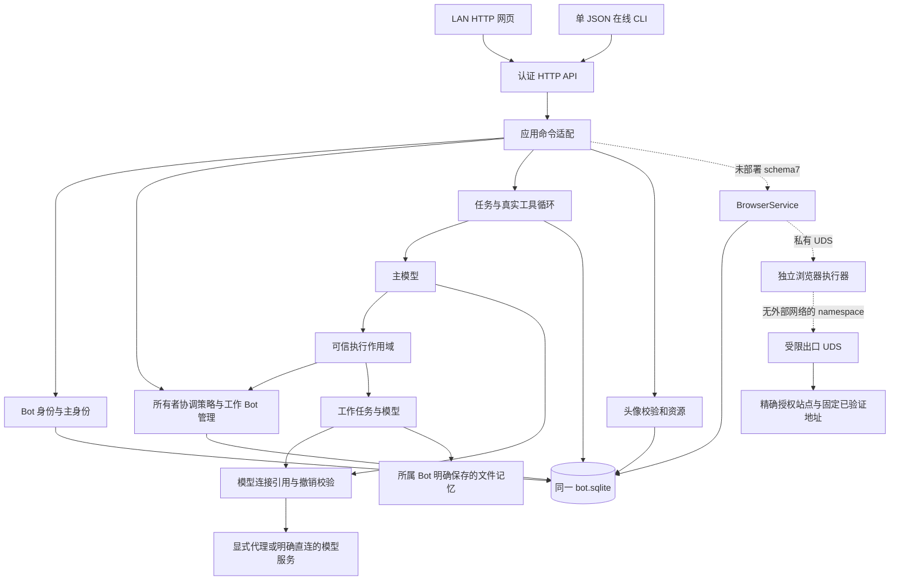

# 独立 Bot 的模块与数据权威

本页只描述 `404404/AI-Bots` 的独立产品。旧 DSH Host 不参与此运行链。实现与逐项验证分别见 [交付计划](../standalone-bot-expansion-plan.md)和[验收记录](../acceptance/standalone-bot-expansion-test-results.md)。下图中的浏览器直接工具接线已在 schema7 源码中实现，尚未部署或通过真实产品验收；当前运行候选仍为 schema6。

## 模块责任

| 模块 | 责任与边界 |
| --- | --- |
| `server.ts` / `cli.ts` | 认证、来源与 Origin 检查、协议和资源响应。CLI 不直接写数据库。 |
| `application.ts` | 把受认证所有者命令交给对应业务模块；组织对话与持久运行。模型参数不能注入 owner 上下文。 |
| `bot-identity.ts` / `bot-fields.ts` | 主 UUID 引用、稳定 Bot ID、名称和 persona 输入规则。名称与 persona 不构成授权。 |
| `worker-management.ts` | 所有者策略、配置版本、原子创建/更新、连接引用和幂等回执。本根创建范围只能从 canonical 记录扩展。 |
| `task-store.ts` / `task-engine.ts` / `root-run.ts` | 任务状态、来源、工具回执、预算、取消和恢复；模型使用实际 SDK 工具协议。每轮目录与服务端实际权限一致。 |
| `connection-resolver.ts` / `codex-auth.ts` | 源 Bot 的秘密归属、消费者引用、epoch 和撤销检查；不复制 OAuth 到消费者，不引用旧 Host。 |
| `avatars.ts` | 真实 PNG 解码、资源限制、安全重编码、revision 与对象资源。 |
| `browser-service.ts` / `browser-client.ts` | **源码已接线、未部署**：应用内授权、会话/步骤/截图事实与固定 UDS 客户端；不启停容器。 |
| `standalone/browser/` | 独立构建的受限执行器、出口和隔离 fixture。模块测试不等于实际沙箱、网络或产品验收。 |

## 唯一持久化来源

| 数据 | 权威 |
| --- | --- |
| Bot、主身份、配置 revision、对话、消息、Run | 独立目录的 `bot.sqlite` |
| 任务父子关系、输入/结果/错误/终态、配置与记忆快照、工具回执 | 同一 SQLite；UI、轮询和通知只读回事实 |
| 所有者策略、连接引用、消费者/委派授权及 epoch | 同一 SQLite；任何模型文字或目录展示都不能替代其校验 |
| API Key、Codex access/refresh grant | 源 Bot 的加密记录；密钥仅位于私有数据目录，消费方使用服务端引用 |
| 人工明确保存的记忆 | 所属 Bot 的受管 Markdown 文件及 revision；聊天不是自动记忆，不提供模型跨 Bot 写记忆工具 |
| 当前头像及 revision | 同一 SQLite 的所属对象记录与安全编码内容 |
| 浏览器 origin 授权、会话、步骤、截图 | **schema7 源码已接线、未部署**，仍使用同一 SQLite 与 canonical task，不创建第二个任务数据库 |
| 活动 AbortController、轮询、worker context | 临时资源，不能推翻已提交终态；异常后有中断/租约清理规则 |

## 权限与失败

所有者可管理产品；主 Bot 仅有已明确授予的协调工具。工作 Bot 只接收本次任务输入、自己的配置和明确保存的文件记忆。共享连接不授予源 Bot 历史或记忆访问权。凭据、权限提升、主身份替换、删除和其他对象的记忆写入不包含在模型管理工具中。

幂等键绑定规范化输入；拒绝或结果重放不能重复产生副作用。取消先写终态再中断请求，迟到结果不能改写取消/中断。重启不盲目重发未完成模型或浏览器动作。镜像回退和数据恢复分别验证，恢复旧备份会丢弃恢复点后的写入。

浏览器网络、协议、下载上传和外部副作用边界详见 [ADR-0246](../adr/0246-independent-browser-runs-behind-a-restricted-network-boundary.md)与[ADR-0248](../adr/0248-browser-tools-share-the-independent-task-authority.md)。严格扫描或沙箱失败即停止，不能自动关闭沙箱或扩大原批准的 seccomp 例外。
