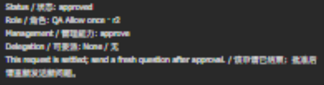
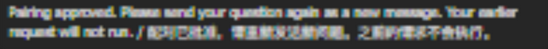
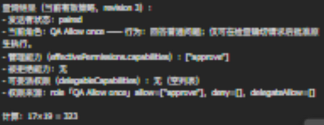
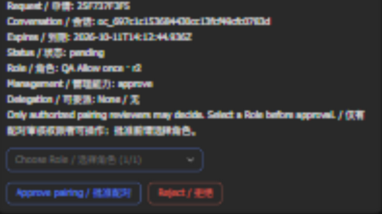
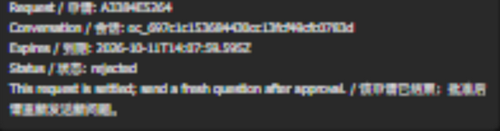

# #1414 verification — 2026-10-11

Product head: `d3cbd0bb4380bc95e57d62cc33be92f9c1010733`.
Product base: `71aa4d06b4ba9619e17cd971c6e303eec9374bf6`.
Provider head: `602baa37fa327f7069545aaadbbd34db8a8f4636`.
Provider base: `81b91291600edba36b1947940c2be8e50abc9fdf`.

## Performed checks

- Product focused coverage: six files / 97 tests passed; pairing-card plus existing native-approval regression: two files / 22 tests passed, including group delegation Deny across restart. These runs overlap and are not additive.
- After the permission-column correction: Client pairing/settings and style-token coverage, two files / 26 tests passed.
- Product lint, typecheck, format, bilingual ledger and ADR-number checks passed. Complete product build passed before the CSS-only correction; the Client rebuild and targeted format check passed after it.
- Provider related Lark transport/controller/delivery coverage: 108 tests passed; build and package verification passed.
- The full local Windows product suite did not finish successfully. The roster-fixture EPERM cleanup failure reproduced in the accepted baseline and current code. [Full Linux CI](https://github.com/BotHarness/DeepSeekBot/actions/runs/38135347584) passed at the exact product head: 483 test files passed / 7 skipped; 4,045 tests passed / 13 skipped, plus lint, format, typecheck and build. [Package preparation and dry-run](https://github.com/BotHarness/DeepSeekBot/actions/runs/38135347641) also passed.
- Full Windows Provider results: candidate 3,729 passed / 36 failed / 7 skipped; baseline 3,723 passed / 39 failed / 7 skipped. No new failing test locations. This is not a full-suite pass.

## Native Web captures

Before is accepted #1406 code at `cefa12fac05856c182bfab4b80f565f7ec074f06`; after is the product head above. Candidate screenshots were captured from the same production code at faf91a729eeddf1aa48832b784f236900593d541; the new head adds only a regression test. Both use fresh isolated Profiles and public UI, with synthetic Role names and no external App binding or receiver.

- Role editor: desktop light/dark and 390 × 844 dark before/after. The candidate saves `review-pairing` for use and `approve` for delegation while own `approve` remains unchecked.
- Additional public native setup flow: sidebar entry, create ordinary `QA Member`, saved Role table and reviewer details, then search `Pairing` with descending Time sort state. These screenshots use the same production code; management review/delegation remains empty on the newly created ordinary Role.
- Group editor: desktop before/after and candidate narrow view. These are preparation-state captures: no App is bound, so Save is disabled. They do not prove group persistence or real Lark activity.
- Candidate permission matrix measured at 390px viewport: body width 390px; columns 86.5 / 51.9 / 51.9 / 51.9 / 51.9px. Controls remain within the dialog, without horizontal overflow.
- T3 automation became unavailable with an explicit “No preview automation host … Do not retry”. Native Web capture continued in the permitted fallback browser. A fresh candidate fallback page reached `shell-ready` with no console errors/warnings. Earlier T3 failed reload attempts remain preserved as diagnostic evidence; no claim that their cause is fixed.

## Pending real group-only acceptance

The Human-authorized QA1 exclusive window is now active on a fresh task-owned isolated Host, with the exact heads above. The reviewer and applicant are two distinct real Lark users in the designated test group. Local receiver owners were checked before start; unrelated task receivers were left stopped. T3 lost its automation host during account switching, so the applicant completed the unavailable-browser interaction manually.

Observed through 2026-10-11 12:57 UTC:
- The reviewer was bootstrapped through authenticated Web public RPC in this Bot/App with use `review-pairing` and delegation `approve`; own execution approval stays absent. No private-DM route was observed.
- A different unpaired applicant's true group @ created a pending metadata-only public review card. Its eligible choices are ordinary `QA Member` and management `QA Allow once`; the review/delegation Role itself is excluded by the current ceiling.
- The Human attempted Role selection and Reject as the applicant and saw “Not authorized or request expired / 未获授权或请求已失效”. Canonical readback before expiry shows pending revision 1, no selection, no granted capabilities and zero external-message Admissions. This records the denied applicant interaction, not an authorized approval.
- A two-minute task cutoff stopped only its own receiver. After the Human's reply, fresh local availability checks preceded restart of the same isolated Profile; the accepted card receipt and pending request survived. The replacement receiver is bounded by another cutoff.

Authorized reviewer selection/approval, final visible card/re-ask, a fresh actual model reply, independent Reject/delayed Deny and full restart qualification, real Lark screenshots and first-flow Human acceptance remain pending.

1. Confirm QA1's original receiver is stopped, record the exclusive start/stop window, and start only the new isolated Host with the exact qualified Provider.
2. Through Web, pair the reviewer in the same Bot/App and assign `review-pairing` plus explicit delegation choices. Keep reviewer DM unobserved for the group-only case.
3. From a different, unpaired Lark actor, @ the Bot in the authorized test group with a unique question marker. Everyone can see a metadata-only review card; no original-question Admission, wake, Task or model execution occurs.
4. Let the applicant attempt Role selection / Reject / Approve. The Host must refuse using the actual callback actor, without changing canonical pairing.
5. Let the reviewer select a Role. Grant a management Role only when its use and onward-delegation capabilities fit the reviewer's current explicit ceiling. Reject an out-of-ceiling choice.
6. Approve: all card copies reach final status, applicant receives the fixed ask-again notice, and only a fresh question produces a model reply. Correlate visible rendering with canonical Source Event, Admission, pairing and Outbox facts.
7. Exercise independent Reject, permission/Deny changes after selection, two reviewers competing for selection, and cold restart without duplicate sends. Optional private copies require an already observed trusted reviewer DM.
8. Stop the exact isolated receiver, record handback, and obtain first-flow Human feedback before codes or platform expansion.

Human acceptance, real Lark card rendering, native E2E, merge and deployment are pending. No credentials, login URLs or private conversation contents are included here.

## Model preparation

In the separate candidate Web DM, the uniquely marked `1414_WEB_MODEL_READY` question produced the actual model reply `323` for 17 × 19. This verifies the isolated Host's model path and shared machine-local credential reuse only. This earlier Web-only model preparation did not accept the real Lark pairing flow; the later bound QA1 run is recorded separately above.

## Later browser attempt — 2026-10-11 13:28 UTC

T3 briefly recovered. The account bar was inspected, the original reviewer's avatar verified, and the inactive account in the same test organization selected. The applicant avatar and designated group were reread after navigation. Through the native mention toolbar and picker, the applicant sent `1414_APPLICANT_RETRY_2222`; the visible message had the applicant author and a real Bot mention. The prior request was visibly expired with controls absent.

**Correction to the first observation:** the first read at 13:21:47 UTC preceded incoming processing. Final canonical readback proves the fresh request was created at 13:21:50 UTC and its group card and pending notice were accepted. This is normal asynchronous processing, not an established inbound gap. The applicant remains pending, revision 1, with zero external-message Admissions, no selection and no private-DM route. No platform permission was changed.

T3 then repeatedly timed out on evaluate/open and reported unavailable. The exact task receiver was stopped and verified no longer running/listening. After corrected canonical readback, another fresh availability check preceded restoring the same isolated Profile for the authorized manual review step. The new pending request/card survived this restart; the Provider is connected. A new exact-PID cutoff bounds the manual window; no original receiver was restarted.

Both PRs remain Draft, Project In Progress. Actual reviewer card selection/approval, final rendering/re-ask, a fresh reply, real Lark screenshots and Human first-flow acceptance remain outstanding. The unavailable-browser step has been requested through Human fallback.

## First real group-only flow verified — 2026-10-11 13:34 UTC

- Two distinct trusted Lark actor IDs in the same designated group. Neither has an observed private-DM route.
- Applicant's unpaired Role-selection/Reject was denied before expiry, with unchanged pending request and zero external-message Admissions. A later fresh native @ created the new public request/card; the pending receipt survived cold restart.
- The Human selected management Role `QA Allow once` and approved as the other, authorized actor through the real group card. Canonical `reviewedBy=paired-reviewer`, reviewer identity differs from applicant, Role revision 2, and card update is accepted. Reviewer use is `review-pairing`; explicit ceiling is `approve`. Applicant effective use is `approve`, delegation empty; no review permission is inherited.
- Browser automation recovered in a new signed-in native T3 tab. The task independently verified the applicant avatar, designated group, final approved card without controls, Role/use/empty-delegation copy and fixed ask-again notice. At this point external-message Admissions remained zero.
- The task sent a true native @ from the applicant with fresh marker `1414_FRESH_APPROVED_2233`. Exactly one external Source Event/Admission was observed. Admission reason is `group-mention`, final state handled with no error. Canonical Outbox is `provider-accepted` with exact reply receipt. Actual group rendering returned `323`, `paired`, Role `QA Allow once`, effective `[approve]` and empty delegation. Earlier applicant question markers did not create Admissions or execute after approval.
- Cropped native screenshot evidence below excludes unrelated conversations and actor names. The canonical Source Event is retained separately from the handled Admission; no claim that the Source Event's own attempt fields changed to handled is made.
- The exact task receiver was stopped at 13:34:50 UTC, with no owned process/listener left. No original receiver was restarted. Test App registration and credentials stay local, unchanged.

**Gate:** first-flow Human feedback has been requested; not yet accepted. Independent authorized Reject, delayed/current Deny and competing review/cold-restart decision cases remain before full issue completion. Pending-card/baseline Lark captures and person exception screenshots remain required visual review work; these final-state crops do not substitute for all matching before/after states. Keep both PRs Draft, Project In Progress. No one-time codes or other-platform expansion started.

## Accepted first slice and remaining real decisions

The Human explicitly accepted the first real group-only slice and authorized remaining qualification. Independent Reject was clicked by the Human as the authorized reviewer; canonical request A3384E5264 and final card are rejected, and the task independently inspected native rendering with controls absent. The task then sent a fresh true @ as the applicant, selected QA Allow once as the other reviewer, applied group delegation Deny through the public Web RPC, and clicked the original Approve button: actual authorization refusal, request still pending, no new Admission. Person review-pairing Deny also refused Reject. A cold restart preserved the exact request/receipt/selection and both Denies; after restoring only person Deny, group delegation Deny continued refusing Approve. Restoring the test group allowed the original selected card to approve; final native rendering had no buttons and fixed re-ask notice. Admissions stayed at the first-flow count of one throughout all pending/rejected/denied decisions. Setup mutations used public authenticated Web RPC; reviewer decisions used real Lark controls. Neither actor gained a private-DM route.

The older historical pending-feedback paragraphs above describe earlier attempts; the latest Human acceptance supersedes that gate. Both source heads are unchanged. Two-reviewer races are covered by public tests, not a claimed live third-user scenario. Matching baseline-version Lark capture and paired-person permission-source/exception screenshots remain visual review work.

## Final remaining qualification and receiver handback

After cold restart and restored authority, only the fresh native @ produced the actual reply **667**, current QA Allow once / use approve / empty delegation. The two external Admissions are handled without errors, and both corresponding Outboxes are provider-accepted with receipts. The approved applicant was revoked through the public Web boundary; its final card is unavailable with no controls. The exact isolated receiver stopped at 2026-10-11 14:10:11 UTC; no owned listener remains, test group removed and person Deny restored. No original receiver was restarted.

Person exceptions were also saved/reopened/restored through the actual native Web UI. The clear and saved-Deny crops are mutation states, not matching baseline-version screenshots; the base comparison requires a separately bound base Profile/App because the earlier baseline has no bound person and no shared group-card feature. Never use the new database with the old writer. Both source heads stay unchanged. Full live Reject/Deny/restart/new-message/revoke qualification is complete; no third live reviewer or code/platform extension is claimed.
