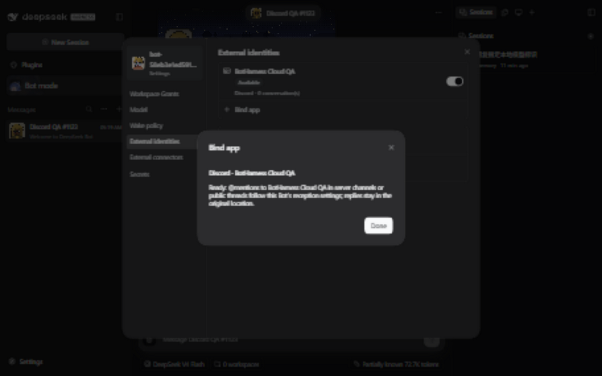
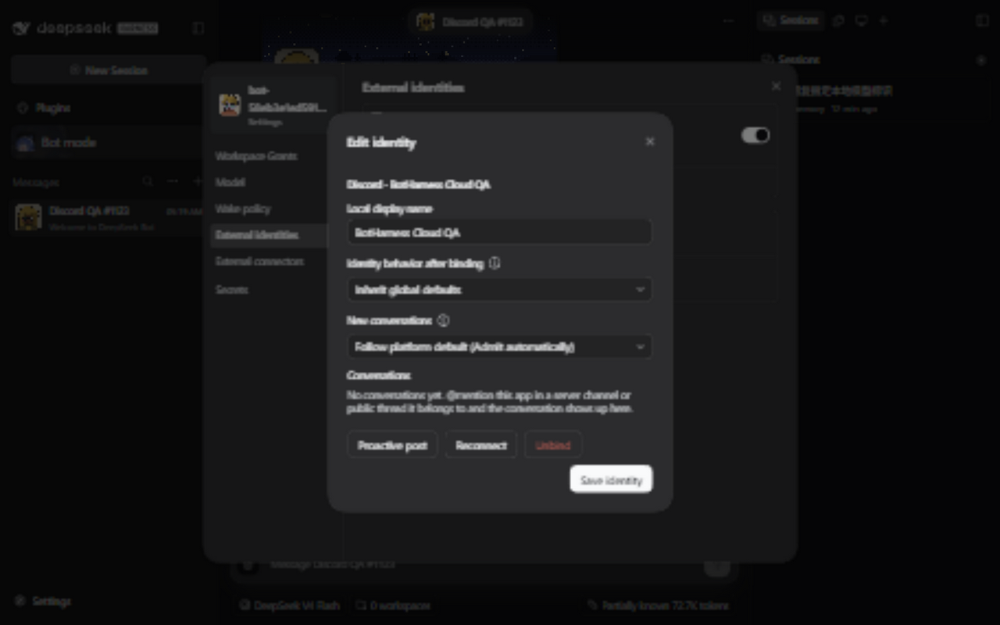

# Discord packaged binding qualification — 2026-10-14

Task `codex/local/01a1342d-5ce4-7872-9f9e-492a9caee393`; [claim](https://github.com/BotHarness/DeepSeekBot/issues/1123#issuecomment-6153367848), [Product #1618](https://github.com/BotHarness/DeepSeekBot/pull/1618), parent [#1107](https://github.com/BotHarness/DeepSeekBot/issues/1107).

## Exact artifacts and receiver window

The task installed six product tarballs for `0.1.0-alpha.1-qa.1123.tokenonly`, built from Product commit `f61f0f20c73df5f1872b368a0cf3c3f50657ba67`, in a fresh isolated Profile using official DSH `0.2.0-rc.1`. The Product UI runtime change is commit `adc38e36`; later commits change the QA setup scripts and documentation. This is installed-package qualification, not npm publication or qualification of a later merge.

The maintained Provider is the already published `@botharness/im-provider@4.32.0-botharness.20`, sourced from `0e5b447f45e4a44d4089eac16cc1fa5673dbd66d`. Its 422-file runtime digest is `1bda59905abe9b761ce7c0d113acdc4b4523d96bc0293b212c4708d0c8dbb733`; archive integrity is `sha512-cJ9kE1H+uytTDh1s9Tg8uJtho6y08wLvc9zqks1S+SrEb7HOfNoW/l4l6BKjtZXtW1KwigN0Ezlrl/siym9nfw==`. No new Provider publication is needed for this slice.

The Human freshly confirmed exclusive **Discord QA1 / BotHarness Cloud QA** before this receiver start. The designated destination was **DeepSeekBot Cloud QA / 常规**, verified in the signed-in Discord web client as account **DoodleBear**. The Token was entered privately by the Human. Read-only native API checks authenticated the actual App/Bot identity, guild/channel association and existing View Channel, Read Message History and Send Messages permissions. No Token reset or platform permission change was performed.

The empty Profile was configured for `external-consumer` before credentials were installed. A real local Bot DM returned the complete `BH_1123_LOCAL_MODEL_20261014_OK`, establishing model usability without an external Discord message.

## Actual binding and native messages

The real installed Client offered **BotHarness Cloud QA** as an enabled Discord choice in **External identities → Bind app**. Selecting it showed the qualified Discord-specific hint. Confirming **Bind app** persisted one available, receiving Binding, initially with zero Grants and zero Outbox intents; no saved delivery target or per-conversation authorization was supplied. The ready state and empty conversation list were inspected in the native Client.

The original plan authorized one @ request and one unmentioned negative. Browser text insertion initially updated the composer DOM without preserving the appended text in Discord's editor state. The submitted first message was therefore only the actual Bot mention; the original channel displayed the reply `BH_1123_OK`. This proved transport and rendering but did **not** prove the intended marker request. It was not counted as a complete marker match.

The unmentioned message `BH_1123_DISCORD_UNMENTIONED_20261014_MUST_IGNORE` was then submitted once. The original channel displayed its full text with no native mentions. It created no external Source Event, Admission or Outbox intent, and no reply. Observation continued for more than three minutes, including the subsequent positive test.

The Human explicitly authorized **one additional @ request** and continued the exclusive window. Browser key input submitted the full `@BotHarness Cloud QA 请只回复 BH_1123_DISCORD_AT_20261014_OK` exactly once. The original channel visibly displayed the complete Bot reply **`BH_1123_DISCORD_AT_20261014_OK`**, attached to that request. Independent native REST reads confirmed the Bot author, exact content, original channel and reply reference.

| Native record                | Message ID            | Result                                                |
| ---------------------------- | --------------------- | ----------------------------------------------------- |
| Initial mention-only request | `1559664410312577025` | Actual mention; appended marker absent                |
| Initial reply                | `1559664446928846859` | `BH_1123_OK`; reply to the initial request            |
| Unmentioned negative         | `1559664615107985420` | Full negative marker; no mentions, admission or reply |
| Authorized complete request  | `1559665519416705155` | Actual mention plus complete requested marker         |
| Complete reply               | `1559665548751798273` | Exact marker; reply to the complete request           |

Canonical final counts were **two** external Source Events, **two** `group-mention` Admissions, both handled/resolved `done`, and **two** `provider-accepted` Outbox intents with native receipts. They correspond to the initial mention-only request and the authorized supplemental request; the negative contributes zero. There is one implicit conversation Grant. Local model-test and welcome-letter events are excluded from these external counts.

The complete request's Source Event is `im-e7239aa78fb3a52fd3503cc759db19bee56c014bd8db55ad77fb9a3725d90410`. Its Outbox text and native receipt match the complete reply above. No standalone Provider session was used for this path.

The exact task-owned Host was stopped at **2026-10-13 20:34 UTC** after capturing the result and reading the canonical facts; its process and listening port were absent afterwards. The exclusive QA1 window ended. A byte scan of 54 task-owned BotHarness state/log and native Session files found zero occurrences of the actual Bot Token; Provider credential storage was excluded and remains private.

## Captures and remaining delivery gates

The following are real captures from this native run at 1280 × 800. The Discord capture hides only unrelated server navigation and account controls before capture; the designated channel and actual messages are unchanged. The native Client captures are English/dark and contain only task-owned QA data.

These are after-state/runtime captures. They are **not** matched base/head before/after pairs. The earlier base checkout has been prepared, but its native before states were not captured before admission changed the Profile from zero to one conversation. Recreating those native states now requires another coordinated receiver window; the finished test's window is not reused. Matched visual evidence remains a PR delivery gate.

Focused checks passed: 32 registry/Client tests, 75 earlier Product discovery/default-traffic/Discord regressions, and 28 exact Provider-source Discord tests. Lint, whole-repository formatting, typecheck and both Release Ledgers passed on `f61f0f20`; the installed artifacts were built successfully.

The full Windows suite remains **not green**: 4,496 passed, 144 failed, 36 skipped. Failures include filesystem/`fsync` errors, Windows path/mode assumptions, timeouts and a Client-bundle VM failure; they have not all been attributed. This record does not call them all baseline failures. Linux CI, matched visual evidence and review remain separate gates; #1123 and #1107 stay open pending delivery. Discord DMs, pairing and interactions remain the separate #1042 qualification scope and were not tested here.
