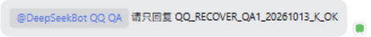
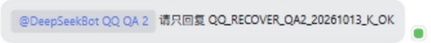
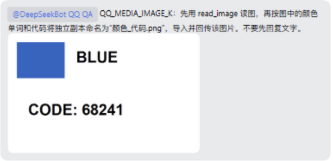
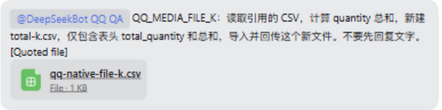

# QQ transport observation and continuation evidence

This material supports the optional observation candidate, audio-card alignment and native mention presentation in product PR #1505 and maintained Provider PR #26. It does not finish #1156 or qualify native own Echo. The Human retains that closure gate.

The [public transport-J result](https://github.com/BotHarness/DeepSeekBot/issues/1156#issuecomment-6129948447) records the original-group matching replies, own-App receipts, Source/Admission/Outbox correspondence, frame completeness and limits. Raw gateway data, native entity locators and credentials remain private.

The HTML [review aid](../../../apps/docs/public/evidence/issue-1156/qq-transport-observer.html) is generated with the repository's `answer-me-with-html` CLI. Its exact Provider base is `8ed7f67c306761a794ca8a5301ce9114bcd84191` and head is `43902c638ac97d4eeaa6845442c5115198f1c9ec`. It is an explanation of that maintained code, not a runtime screenshot. The committed public asset is served with the docs site after publication; local rendering alone does not establish public availability.

## Actual Client local-DM capture

Captured from the actual isolated Client on product `7c9b3b6f3001e47057218cd3c191e9512695b4bc`, Provider `43902c6`, SDK 1.0.4, DSH 0.2.0-rc.1. The original viewport is 1280 × 800. A literal pixel crop removes the left roster's unrelated source preview; the remaining 1000 × 800 pixels are unchanged. No DOM content was substituted. This verifies a local model reply and the visible owning identity, not QQ rendering or native own Echo. Human-confirmed original-group replies are recorded separately in the public result above.

The served current Client contains the exact executable bytes from its checked build; only the terminal source-map comment and trailing whitespace are excluded from the module-assembly comparison. Source mapping and lifecycle captures at the final qualified composition remain separate gates.

## Bilingual guide capture

The new observation section is rendered at its actual insertion point, before group images. Before is the following images section because the observation section did not exist. Both captures use the actual docs UI, dark theme and 1280 × 800 viewport, with the section heading aligned at the same vertical position. Before source is main `0dc823dc15703cea106531d09383dda9a67a76ff`; After source is product `3bff9ec16447956ee04926b800ddc9c6a181d1e9`, which includes main `42734ef7bd94cc2fabf58ad0ef045c705b413642`. These are public-copy captures, not native QQ evidence.

English Before / After:

Chinese Before / After:

## Current audio card and username chips

The current owning App lists were independently opened in each Bot's actual Client settings. Each shows its correct native App name, available state and one current conversation. The literal crops retain the owning Bot heading, App row and Bind app entry while removing unrelated background data.

After captures come from the actual Client on product `6d44dd549ce9cd087c98cf81bc7b923342cb1ee4`, which contains main `9a01a3ef`, with Provider `1eee207c0c23fc98aa26e329f753c1de8b910aff`, SDK 1.0.4 and DSH 0.2.0-rc.2. Both original viewports are 1280 × 800. T3 `preview_open` explicitly reported no automation Host; an independent headless Chrome used the same authenticated owned Profile. Literal pixel crops remove private author names, native conversation IDs and the voice filename. No DOM content or pixels were substituted.

Audio Before is product `6ec097e2`, the same retained 1.7-second voice at the end of playback. After reuses `MessageAudio`, the component for sent attachments. Keyboard play, Home and End succeeded; download returned the original 3,254-byte SILK with the same SHA256 as its previously verified original. These are current Client playback/download checks; native voice ingestion and the Human-confirmed answer `56` remain qualified at product `6ec097e2`.

The two retained native requests now show their native usernames. Each chip's hover ID is 32 characters and matches its native metadata; the chip remains inert. The original group replies for these markers were Human-confirmed on product `28d34471` / Provider `1eee207c`. Their current display is independently captured at `6d44dd54`. A public Before chip screenshot is omitted because the old literal token exposes a private app-scoped native ID. Review reproduction: inspect an unknown-name fixture in `channel-message-body.test.ts`; original text must remain literal. This privacy exception does not qualify Bot self-author identity or Echo.

The current Client's served executable exactly matches the checked `6d44dd54` build after excluding only its terminal source-map comment and trailing whitespace. A native `/api/remote.mux` connection opened; this single-document observation is not a complete multi-document capacity qualification. QA1 Window Companion is enabled and walking; QA2 remains disabled.

The current shared Group settings show two receiving routes, one per owning App, alongside three unavailable historical routes. The latter remain preserved. Public captures crop only the receiving route headers; the full private captures and canonical snapshots separately retain owning identity and mapping evidence.

The generated [audio and mention review aid](../../../apps/docs/public/evidence/issue-1156/qq-audio-mentions-review.html) explains product code `6d44dd54` and Provider `1eee207c`. The delivery PR comment must bind the asset to its exact published head and record actual accessibility checks; local generation alone does not establish public delivery. It is an explanation, not native QQ evidence. Final current-process group replies and image/file native qualification remain pending; native own Echo remains the closure blocker.

## Updated bilingual guide view

These current After captures render the checked static docs build at source `0952790f`, including the audio/mention paragraph and the exact Provider `1eee207c` link. Both use the actual docs UI, dark theme and 1280 × 800 viewport; the heading is aligned with the historical Before captures above. The filtered Astro build completes 494 pages. These public-copy captures do not qualify native media ingestion or own Echo.

## Recovered Profile and fresh native qualification — K

The 2026-10-13 continuation recovered the same isolated Profile after confirming that its recorded Host was no longer running. A new generation-83 consistent SQLite snapshot passed integrity checks. Both original receivers remained guarded stopped. The restored product is `2edb56d539c960b5d5491b5d305c474011401ba7`, whose five checked runtime artifacts match code `6d44dd54`; Provider remains `1eee207c`, SDK 1.0.4 and DSH 0.2.0-rc.2. Both independent bindings, active shared mappings and all 14/15 accepted Outbox facts survived.

Both fresh local DMs received genuine replies through the actual T3 Client. The Human confirmed both complete K markers in the original QQ group. Each has one handled owning Inbox Admission, available Source, own-App accepted Outbox/native receipt and shared placement, with zero foreign-marker Admissions. Each additional Attention in the K checkpoint is independently tied to that Bot's local Human DM. The two native username chips retain matching 32-character IDs.

QA1's media run used `opencode-go/qwen3.8-flash`, verified in the actual native request header. Native `read_image` returned an image block; the Bot then named its independent PNG copy `BLUE_68241.png`, imported it and sent one own-App native image result. QQ supplied a 9,372-byte PNG; the Client preview, saved original and returned copy have matching hashes. This does not claim byte equality with the image before QQ processed it.

The explicit quoted-file request supplied a 33-byte CSV. Native `read` and `write` produced a distinct 18-byte `total-k.csv` containing `total_quantity` and `42`, followed by import and one own-App native file result. The Client download and original working copy match the input fixture hash. The first attachment lookup returned `resource-unavailable`; the model used `bridge_read` to obtain the correct attachment reference before saving successfully. That refusal remains in the evidence. It did not create a send.

The Human confirmed receiving both native results, the returned image's blue square / BLUE / 68241, and the downloaded CSV's exact `total_quantity` / `42` contents. Each media Source has one handled owning Inbox Admission, one shared placement and one own-App Outbox/native receipt. The media checkpoint has exactly two new QA1 Admissions/Outbox facts and zero new QA2 Admissions/Outbox. The image preview loads at 640 × 400; Escape closes its enlarged view and restores focus. File download via keyboard Enter and authenticated byte/hash checks pass. All captures use the actual T3 Client at 1280 × 800; literal crops remove private authors, native conversation IDs and unrelated content. No DOM text or screenshot pixels were substituted.

After processing, QA1's original DeepSeek model preset was restored and the dedicated QA Workspace Grant was revoked; test files remain intact. The restored route received a new real DM reply and its native request header uses `deepseek-v4-flash`.

The K text observation contains three group frames per App, all present at the SDK WebSocket, Gateway and normalized callback boundaries. Per-App start/end counters match 20 received/decoded frames, including heartbeats, without parse/processing refusal, suppression or capture failure. Each observed Bot author matches the scoped foreign mention from a Human frame, with no self-author or same-App receipt ID/reference match. Core Echo remains zero. This limited observation does not prove platform-wide absence; neither successful media nor a receipt qualifies own Echo.

Code integration `f08c35c9ce9621049adafd6a074cd9bfe0c984c2` includes main `e68b04b2c2be094fa7fa2c3c5475386ff7474adf`. Its 93 focused integration regressions, 13 Provider/model-helper checks, typecheck, lint, format, bilingual ledgers and product build pass. It has not replaced the qualified `2edb56d5` Host; no fresh native or Client qualification is claimed for that merged composition. The [K review aid](../../../apps/docs/public/evidence/issue-1156/qq-native-qualification-k.html) explains these separate boundaries. With explicit Human authorization, the continuation published a sanitized [native contract question to the official Tencent SDK repository](https://github.com/tencent-connect/qqbot-nodejs/issues/8). No supported own-reflection condition is inferred while that answer remains pending. Native own Echo still gates #1156 closure; no sibling closure, SDK upgrade, App permission change, Provider release or production cutover occurred.
