# QQ transport observation and continuation evidence

This material supports the optional observation candidate, audio-card alignment and native mention presentation in product PR #1505 and maintained Provider PR #26. It does not finish #1156 or qualify native own Echo. The Human retains that closure gate.

The [public transport-J result](https://github.com/BotHarness/DeepSeekBot/issues/1156#issuecomment-6129948447) records the original-group matching replies, own-App receipts, Source/Admission/Outbox correspondence, frame completeness and limits. Raw gateway data, native entity locators and credentials remain private.

The HTML [review aid](../../../apps/docs/public/evidence/issue-1156/qq-transport-observer.html) is generated with the repository's `answer-me-with-html` CLI. Its exact Provider base is `8ed7f67c306761a794ca8a5301ce9114bcd84191` and head is `43902c638ac97d4eeaa6845442c5115198f1c9ec`. It is an explanation of that maintained code, not a runtime screenshot. The committed public asset is served with the docs site after publication; local rendering alone does not establish public availability.

## Actual Client local-DM capture

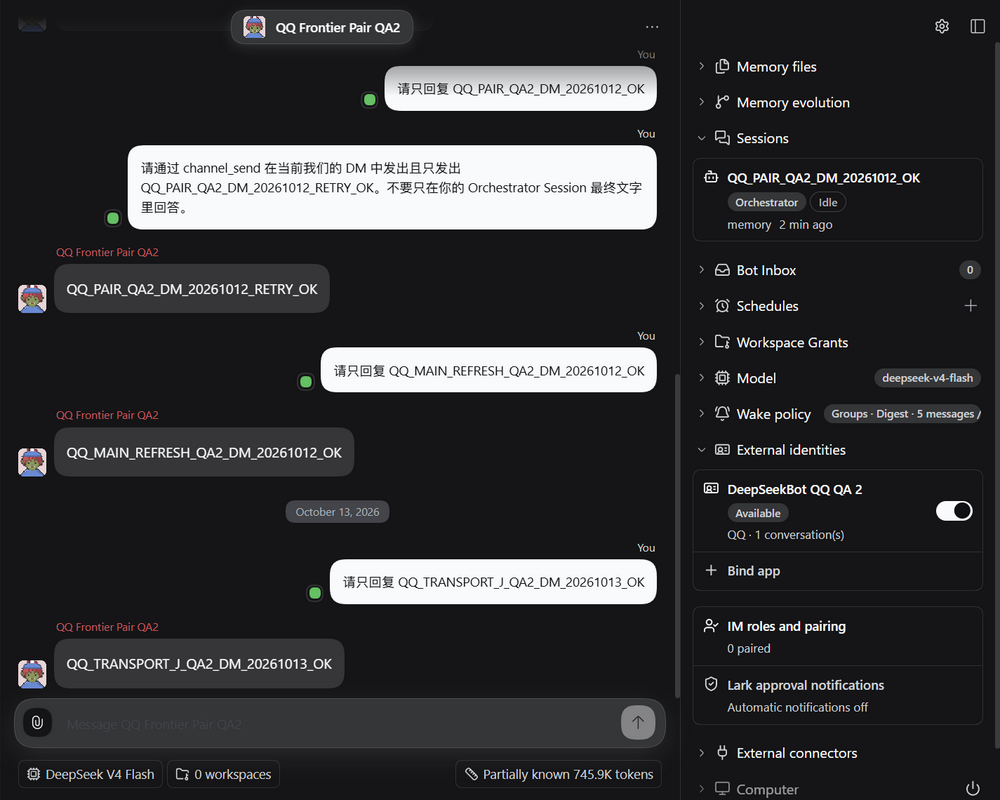

Captured from the actual isolated Client on product `7c9b3b6f3001e47057218cd3c191e9512695b4bc`, Provider `43902c6`, SDK 1.0.4, DSH 0.2.0-rc.1. The original viewport is 1280 × 800. A literal pixel crop removes the left roster's unrelated source preview; the remaining 1000 × 800 pixels are unchanged. No DOM content was substituted. This verifies a local model reply and the visible owning identity, not QQ rendering or native own Echo. Human-confirmed original-group replies are recorded separately in the public result above.

The served current Client contains the exact executable bytes from its checked build; only the terminal source-map comment and trailing whitespace are excluded from the module-assembly comparison. Source mapping and lifecycle captures at the final qualified composition remain separate gates.

## Bilingual guide capture

The new observation section is rendered at its actual insertion point, before group images. Before is the following images section because the observation section did not exist. Both captures use the actual docs UI, dark theme and 1280 × 800 viewport, with the section heading aligned at the same vertical position. Before source is main `0dc823dc15703cea106531d09383dda9a67a76ff`; After source is product `3bff9ec16447956ee04926b800ddc9c6a181d1e9`, which includes main `42734ef7bd94cc2fabf58ad0ef045c705b413642`. These are public-copy captures, not native QQ evidence.

English Before / After:

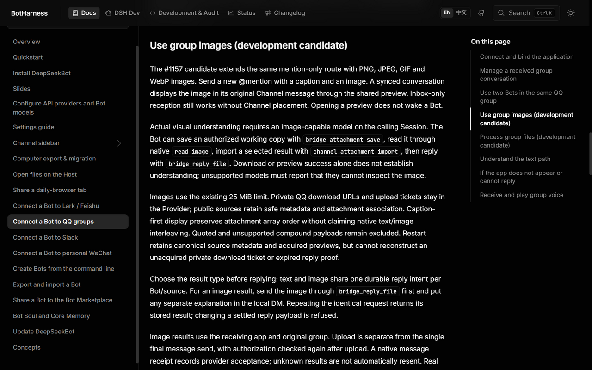

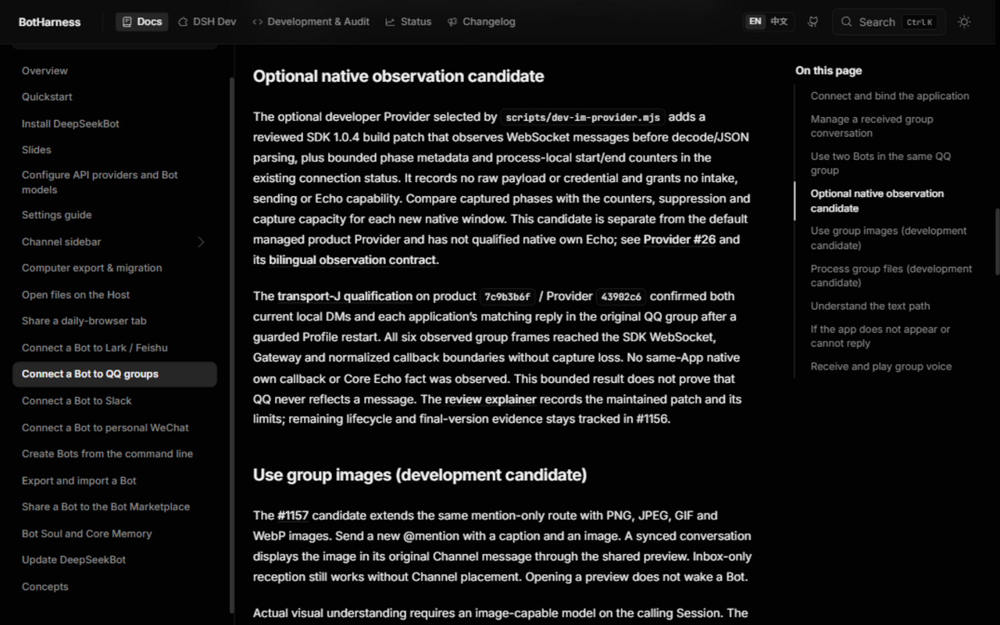

Chinese Before / After:

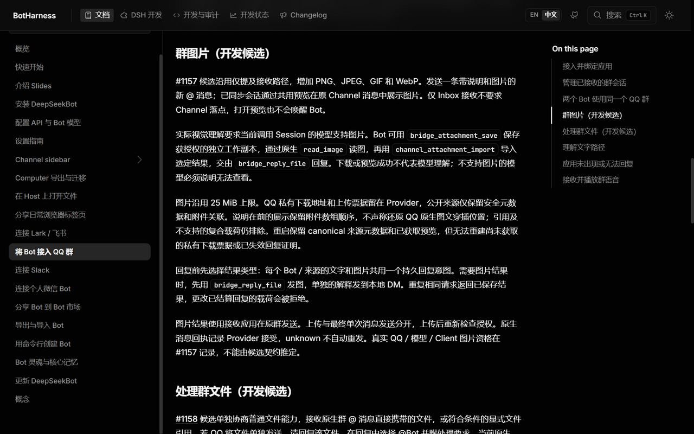

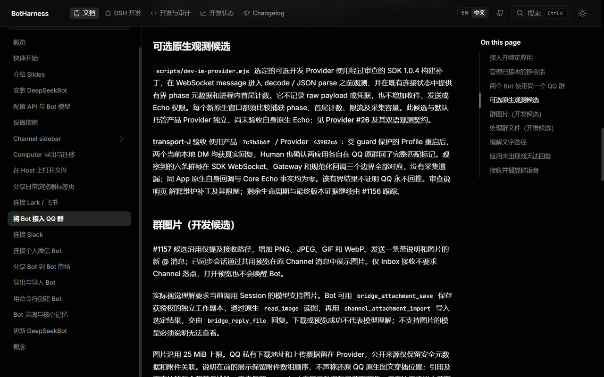

## Current audio card and username chips

The current owning App lists were independently opened in each Bot's actual Client settings. Each shows its correct native App name, available state and one current conversation. The literal crops retain the owning Bot heading, App row and Bind app entry while removing unrelated background data.

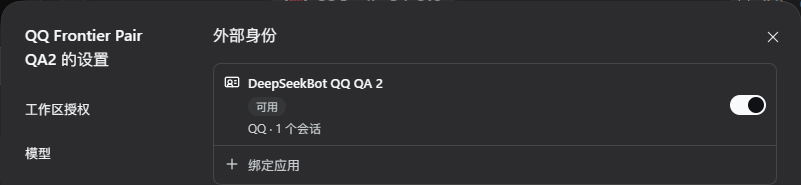

After captures come from the actual Client on product `6d44dd549ce9cd087c98cf81bc7b923342cb1ee4`, which contains main `9a01a3ef`, with Provider `1eee207c0c23fc98aa26e329f753c1de8b910aff`, SDK 1.0.4 and DSH 0.2.0-rc.2. Both original viewports are 1280 × 800. T3 `preview_open` explicitly reported no automation Host; an independent headless Chrome used the same authenticated owned Profile. Literal pixel crops remove private author names, native conversation IDs and the voice filename. No DOM content or pixels were substituted.

Audio Before is product `6ec097e2`, the same retained 1.7-second voice at the end of playback. After reuses `MessageAudio`, the component for sent attachments. Keyboard play, Home and End succeeded; download returned the original 3,254-byte SILK with the same SHA256 as its previously verified original. These are current Client playback/download checks; native voice ingestion and the Human-confirmed answer `56` remain qualified at product `6ec097e2`.

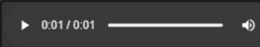

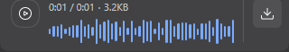

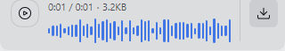

The two retained native requests now show their native usernames. Each chip's hover ID is 32 characters and matches its native metadata; the chip remains inert. The original group replies for these markers were Human-confirmed on product `28d34471` / Provider `1eee207c`. Their current display is independently captured at `6d44dd54`. A public Before chip screenshot is omitted because the old literal token exposes a private app-scoped native ID. Review reproduction: inspect an unknown-name fixture in `channel-message-body.test.ts`; original text must remain literal. This privacy exception does not qualify Bot self-author identity or Echo.

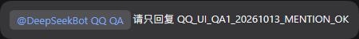

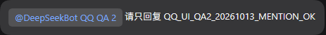

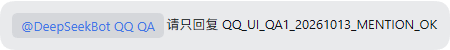

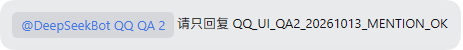

The current Client's served executable exactly matches the checked `6d44dd54` build after excluding only its terminal source-map comment and trailing whitespace. A native `/api/remote.mux` connection opened; this single-document observation is not a complete multi-document capacity qualification. QA1 Window Companion is enabled and walking; QA2 remains disabled.

The current shared Group settings show two receiving routes, one per owning App, alongside three unavailable historical routes. The latter remain preserved. Public captures crop only the receiving route headers; the full private captures and canonical snapshots separately retain owning identity and mapping evidence.

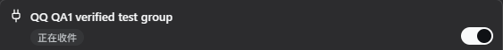

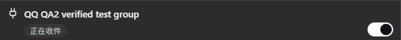

The generated [audio and mention review aid](../../../apps/docs/public/evidence/issue-1156/qq-audio-mentions-review.html) explains product code `6d44dd54` and Provider `1eee207c`. The delivery PR comment must bind the asset to its exact published head and record actual accessibility checks; local generation alone does not establish public delivery. It is an explanation, not native QQ evidence. Final current-process group replies and image/file native qualification remain pending; native own Echo remains the closure blocker.

## Updated bilingual guide view

These current After captures render the checked static docs build at source `0952790f`, including the audio/mention paragraph and the exact Provider `1eee207c` link. Both use the actual docs UI, dark theme and 1280 × 800 viewport; the heading is aligned with the historical Before captures above. The filtered Astro build completes 494 pages. These public-copy captures do not qualify native media ingestion or own Echo.

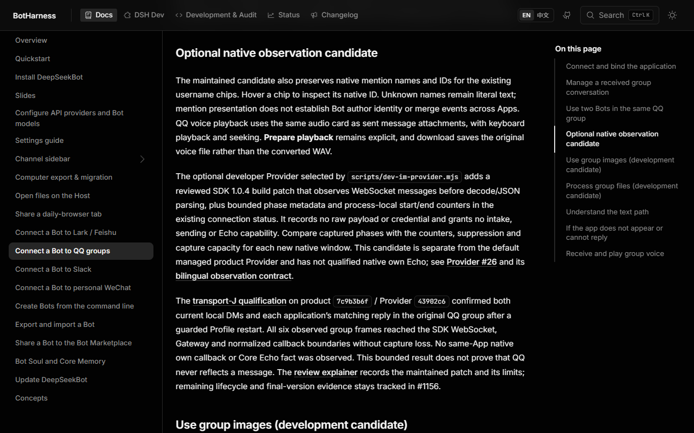

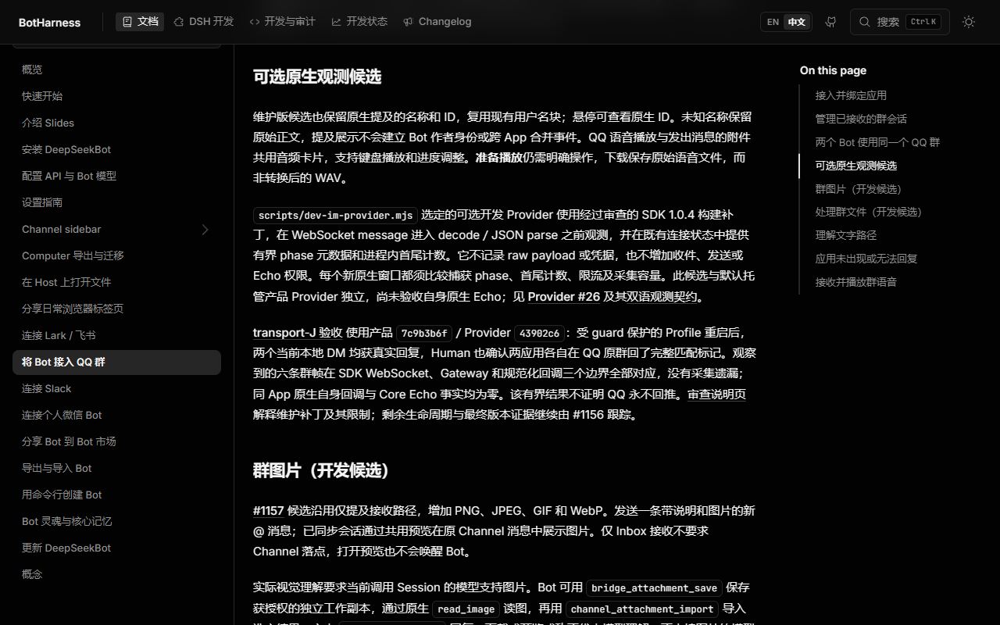
