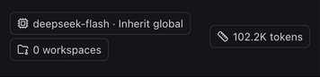
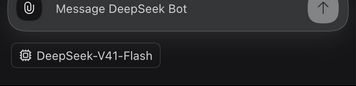
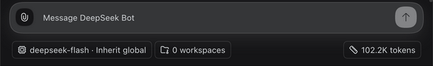
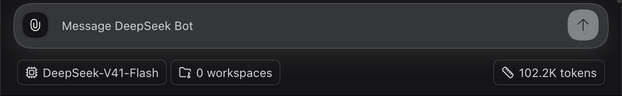

# Channel footer evidence — issue #1479

Captured on 2026-10-13 from an isolated real DSH Host, using baseline
`058e727d` and the implementation on `codex/1479-channel-footer`.

| View | Before | After |
| --- | --- | --- |
| Mobile, 390 × 844 CSS px |  |  |
| Desktop, 1280 × 800 CSS px |  |  |

Both pairs use English, dark theme, the same Bot, inherited DeepSeek-V41-Flash
model and 102.2K usage fixture. Crops exclude message bodies and unrelated
content. Mobile crops show only the footer; desktop crops include the composer.

## Verification boundaries

- The T3 preview's native resize timed out. Captures use a same-origin iframe
  with the stated CSS viewport dimensions, loading the real authenticated Host.
  They are embedded responsive-viewport checks, not native device emulation.
- Real UI: selecting DeepSeek-V4-Pro and saving updates the footer; restoring
  inheritance returns DeepSeek-V41-Flash. Selecting Pro and cancelling leaves
  the inherited model unchanged. Desktop restores workspace and usage controls.
- Layout stress: a DOM-only long-label fixture wraps at 320px, 390px and desktop
  without increasing document scrollWidth beyond the viewport. This does not
  represent a newly configured or executed model. The real label was restored.
- Light theme was visually inspected on mobile and desktop; dark theme is
  shown in the paired captures. Theme inspection changed only the native body
  theme attribute, not persisted settings.
- Client diagnostics reported `shell-lost` for two attempts and one stale
  attempt during browser navigation/replacement; diagnostics are not green.
  Visible real footer rendering and selector operations were checked separately.
- Focused tests: 35 passed across four files. Typecheck, lint, format, build and
  bilingual release-ledger checks passed. Full suite: 4253 passed, 13 skipped,
  one failure in `scripts/test/dev-im-test-apps.test.mjs:96`; that same failure
  reproduced on the unchanged baseline (wizard subprocess exits 2, expected 0).
- Physical-phone/Mobile Safari, native keyboard focus and Human QA remain
  separate pending checks. No merge or deployment is included.
