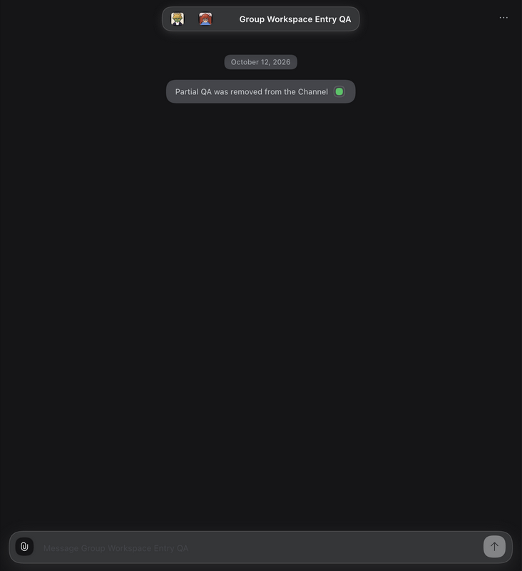
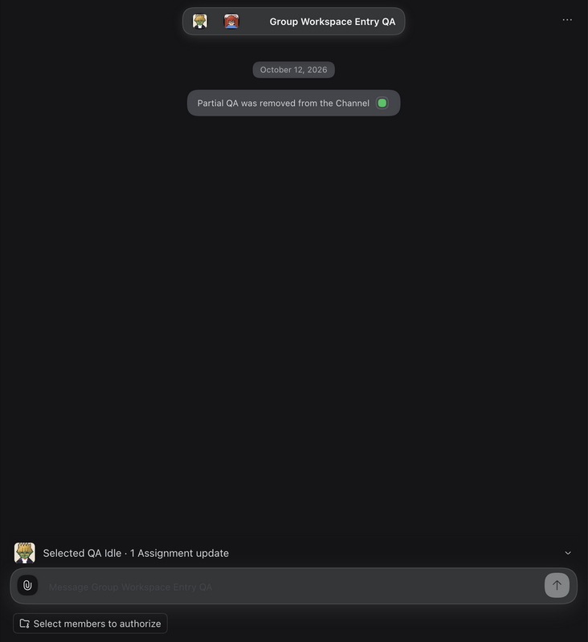
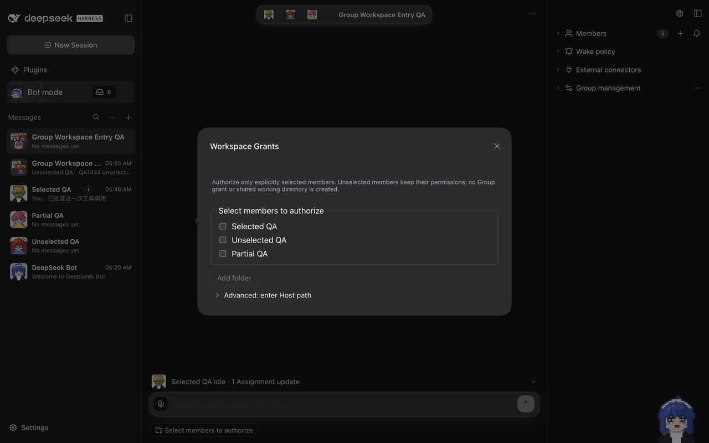
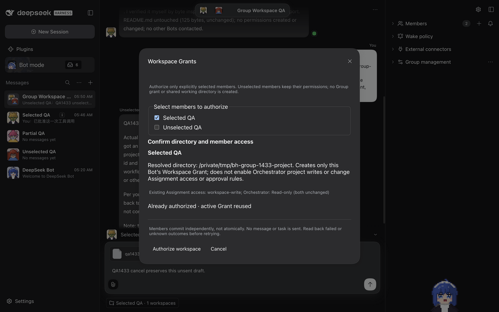
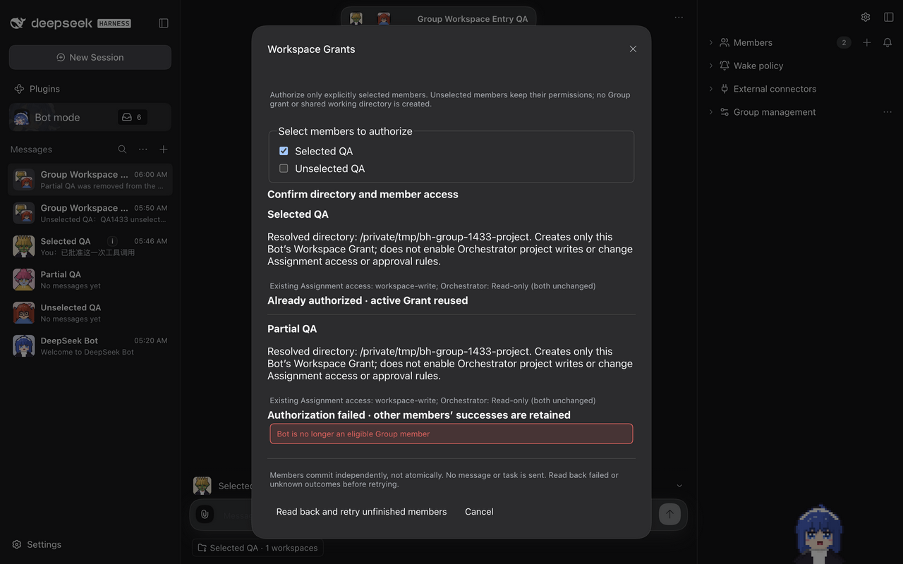
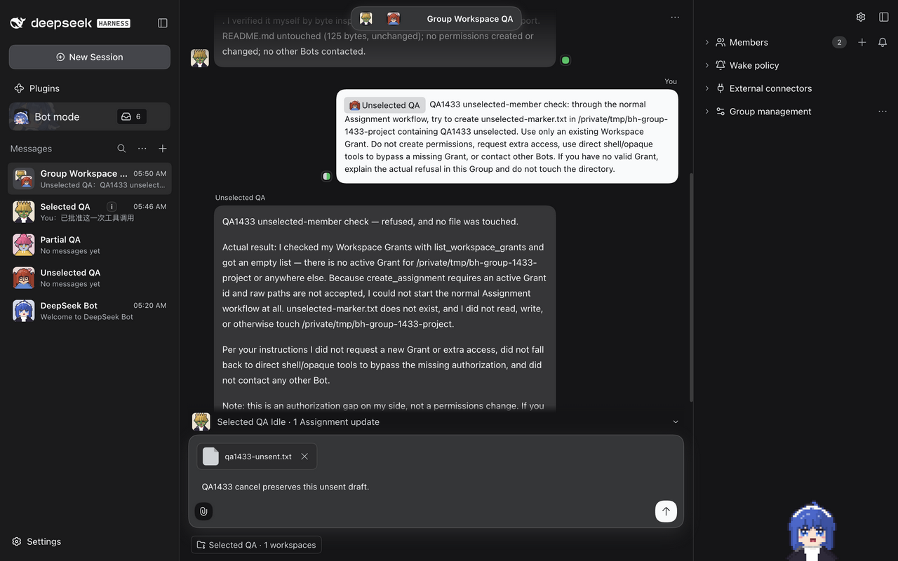

# #1433 — Group composer Workspace Grant verification

## Revision and dependency gate

- Issue: [#1433](https://github.com/BotHarness/DeepSeekBot/issues/1433); parent: #1431.
- Dependency #1432 was explicitly Human-accepted in [the acceptance comment](https://github.com/BotHarness/DeepSeekBot/issues/1432#issuecomment-6113040095), not inferred from its closed state. PR #1441 merged; [completion](https://github.com/BotHarness/DeepSeekBot/issues/1432#issuecomment-6113130888) records the accepted baseline.
- Base: `184edf23b422a69b9f04bdfde29e35e40c88f3a0`. A separate checkout runs this exact base for the before capture.
- Task: `codex/local/01a12c92-1feb-7823-8fb8-f603fad9ca1d`; [claim](https://github.com/BotHarness/DeepSeekBot/issues/1433#issuecomment-6113191966); branch: `codex/1433-group-workspace`.
- Run date: October 12, 2026, Asia/Tokyo (October 11, 2026 UTC). The PR body and outcome comment record the current head. The screenshots and real-model delegation below belong to `c5f962824d8aab1ab5103f4784e6ab8f20f88a4a`, before the compact-modal feedback revision; they are not claimed as screenshots of the revised layout.

## Setup and proof boundaries

Two disposable, isolated native DSH `0.2.0-rc.1` Profiles run through the repository's verified dev launcher: baseline and implementation. The implementation uses a real DeepSeek model, not a canned reply. The Group and three synthetic PersonaBots are prepared through authenticated native RPC as **fixture setup**, not counted as UI evidence. The disposable project directory contains a README and no personal files. Opaque Bot, Grant, Workspace and Session IDs, credentials and Profile paths stay private.

The browser is the T3 collaborative preview. Slash selection, checkboxes, confirmation, cancellation, approval and normal Group messaging use the rendered React UI. Some controls are activated using DOM `click()` through preview evaluation after locator actions fail. The unsent text attachment is a synthetic browser `File`, attached through the existing file input and its real change handler. Canonical RPC reads corroborate the visible behavior; they are not substitutes for model execution or screenshots.

Directory preview may register and resolve a native DSH Workspace. It does **not** create a Workspace Grant. There is no Channel Workspace Binding, Group Grant, shared cwd, model batch change or Companion batch change. Permission proof concerns the existing Workspace Grant/Assignment boundary, not an assertion that every opaque tool is an OS sandbox.

## Native Group run

1. Open `Group Workspace QA`; type `/workspace` and select its existing composer shortcut. All members start unchecked; directory actions are disabled until a member is explicitly selected.
2. Select **Selected QA** and **Partial QA**; leave **Unselected QA** unchecked. Use the shared folder picker to resolve the disposable project directory. Before confirmation, all three Bots have zero Grants and zero Assignments.
3. Confirm both targets, canonical directory, existing `workspace-write` Assignment mode and read-only Orchestrator access. Remove Partial QA from this test Group between preview and confirmation using the existing membership operation.
4. Submit through the UI. Selected QA receives one new Grant. Partial QA is refused as no longer eligible. Unselected QA receives no Grant. The successful row remains visible alongside the refusal.
5. Retry unfinished members through the UI. Failed membership readback prevents another write; the selected Grant keeps the same identity and count.
6. Mention Selected QA through the actual Group `@` picker and send a normal request to create `selected-marker.txt` through an Assignment. Its real Assignment completes with the active Grant, project cwd, `workspace-write`, approval `ask`, and a completed report. The Bot replies visibly in the original Group.
7. The model asks for bounded directory inspection via opaque `bash`. Only **Allow once** is used for the displayed read-only commands against the disposable fixture. No permanent approval rule is created; `orchestratorWrite` remains false. The file write is executed by the Assignment, not by the coding agent or a setup RPC.
8. Mention Unselected QA and request a different marker through the same normal Assignment workflow, explicitly without obtaining access or bypassing missing authorization. Its real model reads an empty Grant list and refuses in the Group. It creates no Assignment and no marker file. No opaque tool approval is granted to this Bot.
9. Enter an unsent draft and attach `qa1433-unsent.txt`. Open the workspace chip, then cancel. The exact draft and attachment remain; Grant and Assignment counts do not change. Authorization never sends a task automatically.
10. Reopen the picker for Selected QA's existing project and confirm. The result says **Already authorized**, with the original Grant identity retained. An independent entry fixture repeats the partial-member departure case on the final source tree: Selected QA's existing Grant remains successful while Partial QA fails and Unselected QA stays unchecked.

### Authoritative readback and filesystem corroboration

| Synthetic Bot |                      Active Grants | Assignment result                            | Orchestrator project write | File result                  |
| ------------- | ---------------------------------: | -------------------------------------------- | -------------------------- | ---------------------------- |
| Selected QA   | 1, same identity after retry/reuse | completed; project cwd; workspace-write; ask | false, revision unchanged  | selected-marker.txt exists   |
| Unselected QA |                                  0 | no Assignment                                | no Grant                   | unselected-marker.txt absent |
| Partial QA    |                                  0 | no Assignment                                | no Grant                   | no operation                 |

The selected marker is 33 bytes: `QA1433 selected member completed` followed by LF. SHA-256: `ba8f796dafe565a694d3a3e7dc4faab429fb80a01a07e1b5e8881b0718f3cb6c`. The coding agent independently reads the completed file after the Assignment. The original 125-byte README remains unchanged. Model statements about these files are cross-checked, not accepted as execution proof by themselves.

## Rendered evidence

### Compact-modal feedback revision

Human requested alignment with the DM workspace modal and less small, repetitive copy. The Group modal still uses the same folder picker and confirmation seam. It adds compact explicit-member choices, displays the canonical directory and unchanged permission policy once, and keeps concise per-member access/status rows. Member choices are replaced by the confirmed target rows during confirmation; Cancel returns to selection. Detailed authorization and partial-result rules are available through a collapsed disclosure. No authorization behavior changes.

The running DM composer modal measures 380 CSS px wide. The revised Group modal measures 480 CSS px wide, leaving room for member/status rows without the former 620 px width. Native DOM readback in the synthetic `Group Workspace Compact QA` verifies a single displayed canonical directory, collapsed rules, two confirmed targets, `Authorized · reused` alongside `Failed`, a concrete departed-member refusal, and successful-result preservation after `Read back and retry`. Canonical Grant counts remain Selected QA: 1, Unselected QA: 0, Partial QA: 0. This repeat uses the real rendered UI and authenticated Host; it does not repeat the earlier real-model Assignment execution.

**New visual evidence is pending.** T3 preview screenshot capture repeatedly fails, including in a fresh preview tab. The compact UI is not visually accepted based on DOM measurements or older images. Existing images remain explicitly bound to the pre-compaction head. Human QA and fresh GitHub-rendered compact-modal screenshots are still required before merge.

### Pre-compaction captures

Screenshots are native UI captures, not reconstructed or annotated mockups. The entry pair uses matching dark theme, English locale, synthetic Group name and two remaining members. It is cropped identically from 1280 × 800 captures to the central 732 × 800 panel; fixture roster details outside this panel differ between isolated Profiles. Other images retain the 1280 × 800 capture. A transient screenshot-tool failure was retried through the same T3 tool; no alternate browser capture was substituted.

**Before — accepted main has no Group workspace chip.**

**After — no implicit target; the chip asks Human to select members.**

**Same composer menu and default-unselected entry.**

**Shared confirmation and independent partial results.**

**Real normal delegation, real refusal, and unsent draft/attachment retention.**

## Automated validation and remaining gates

Focused coverage includes Group selection isolation, partial failures, lost-response readback, no-write-on-unavailable-readback, preservation after membership changes, shared DM picker canonicalization, composer lifecycle and existing sidebar notifications, bridge scope fences, and post-await Grant commit validation. Typecheck, lint, release-ledger checks, formatting, build and documentation validation are reported separately in the PR against its final head.

The full repository suite is not declared green when unrelated failures remain. The synthetic-stdin reusable IM-app wizard failure is reproducible on the unchanged baseline. An architecture MDX failure found during validation was caused by placing this PR's paragraph before the maintained-source comment; the paragraph was moved after the comment, and the isolated docs build test passes. The final full-suite outcome is recorded in the PR rather than inferred from focused tests.

Native Group E2E is not Human QA, physical-phone QA, CI, merge or deployment. No mobile-device or external IM-provider qualification is claimed by this desktop-native slice. Human QA must explicitly approve the exact PR head before merge; this task does not merge it.

## Human acceptance path

1. Launch the PR worktree with an isolated Profile using `node scripts/dev-instance.mjs --home <private-isolated-home> --port <free-port> --build`; configure a usable native model privately.
2. Create a Group with at least three test Bots and a disposable project directory. Check Grants before the run.
3. Use both `/workspace` and the chip. Verify no default selection, canonical directory and per-target scope. Cancel with a draft and attachment; check they remain and no Grant is created.
4. Select two Bots, not the third. Remove or pause one selected Bot after preview. Confirm; check successful and failed rows independently, then retry. Verify the unselected Bot has no new Grant and successful Grant identity is stable.
5. Normally mention the authorized Bot and ask for one harmless directory-local file operation. Inspect the actual completed Assignment, cwd and Group reply. Mention the unselected Bot without granting extra access; verify refusal and absence of its marker.
6. Check the same Bots' existing DM sidebar Grant state. Use existing per-Bot revocation when cleaning up intentional access. Code rollback alone does not revoke Grants already created by Human confirmation.
7. Record explicit Human QA acceptance on the PR's exact head, or concrete failures. Do not infer acceptance from issue closure, passing tests or screenshots.
