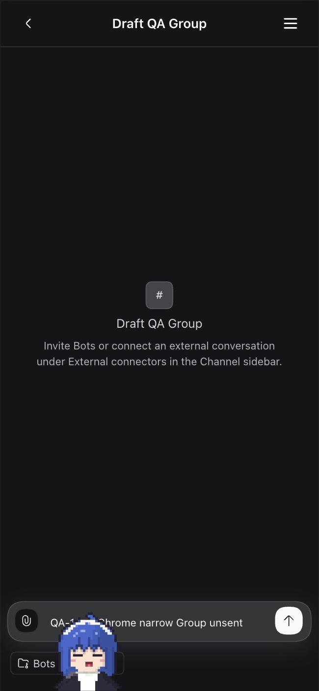
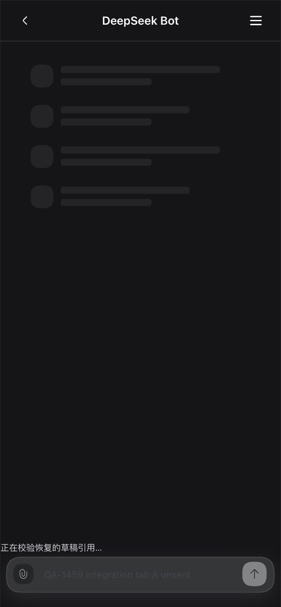
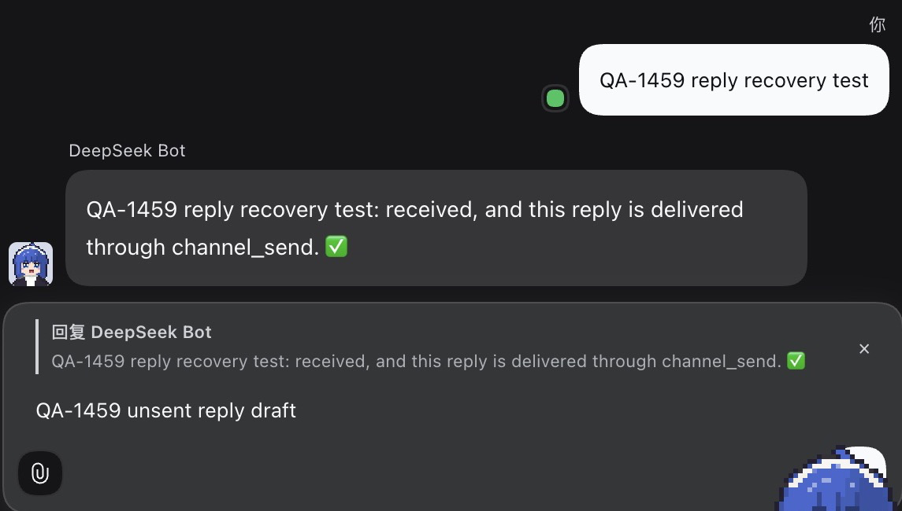
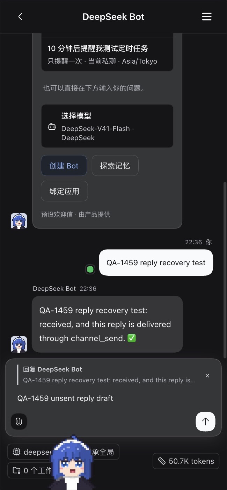

# Chrome acceptance continuation

Date: 2026-10-12. Issue #1459 / Draft PR #1467. Runtime source remains `66458b48eea03e8f94f014dd921d2dc3d725739c`; the observations below made no runtime fix, commit, merge or deployment. A later documentation-only follow-up publishes these retained captures; its exact head and continuation boundaries are recorded in [the handoff](handoff.md).

## Published-head narrow viewport

Chrome's Responsive device toolbar measures `innerWidth=390`, `innerHeight=844`, with the same VisualViewport dimensions. Separate unsent DM A, DM B and Group text drafts survive reload and reopening each Channel through the narrow conversation list. The Group has no document horizontal overflow. Input is DOM-assisted through the native DevTools console, not native IME qualification. This updates the earlier T3-only narrow-viewport blocker; it is not physical-phone or Safari proof.

Two same-origin Chrome Bot-mode documents still leave the peer's recovery validation and message loading pending. Returning the other document to the list does not resolve it; leaving Bot mode eventually does. This is recovery by releasing demand, not uninterrupted dual-tab acceptance.

## Temporary prerequisite integration probe

A detached, disposable source tree starts at the published head above and imports only seven runtime/test files from PR #1454's delta, base `fd66226d671f18478f2d00b4e9208b536dd560c4` to head `f8062a7703df1b9ad5b019230ff0a0736f5648cd`. No prerequisite ancestry, release-ledger changes or commits are retained. Imported patch SHA-256: `e091bb04a0cc2bc26dc7218258a697053c6ef559a4b709435673c7fc733efd0a`.

- Correct focused filters cover composer store, composer recovery, mobile panel, messaging defaults live, Channel live and Client bundle: **6 files, 63 tests passed**. Typecheck, build and whitespace checks also pass. An earlier three-file/36-test run used two nonexistent filters and is not five-file coverage.
- A database-only backup probe fails launcher health with `gateway/internal` and is stopped by the launcher. Cause is not established. A separate fresh isolated Profile passes authenticated launcher health and renders the native Client and Bot DM. No existing Profile is modified.
- In the fresh Profile, A's DM is editable and its model selector resolves. An unsent text draft is entered through the actual textarea with a DOM-assisted input action. B opens the same DM while A remains in Bot mode; B displays the saved text but disables its composer with “Checking restored draft references” and continues loading messages.
- B remains blocked at the subsequent readback. Network inspection shows sampled onboarding and human-attention fetches pending. This is not an exact socket-count measurement or proof that every request is pending. No request interception, authentication bypass or application-internal state manipulation is used.
- The controlled seven-file composition therefore **does not qualify uninterrupted dual-tab recovery**. It does not establish that PR #1454's independently tested stack fails, nor is it qualification of the standalone published #1467 head. Coordinate this reproduction with the existing #1451/#1454 owner before changing their transport work.

## Remaining gates

At current GitHub readback, #1467 is Draft at the unchanged published head and only CodeRabbit's Draft-review-skipped success is present. No final-head Actions qualification is claimed. PR #1454 remains open/Draft and unmerged.

At the end of the initial probe, uninterrupted dual-tab recovery, real valid-reply restoration, actual revocation/deletion, native IME, deliberate welcome-chip sending, second-Host live identity isolation, required exact-head CI and Human QA remain separate gates. No test message or schedule is sent in that initial probe. Do not merge, deploy, start dependent issues or mark acceptance complete.

## Authorized real reply restoration follow-up

The Human subsequently authorizes exactly one `QA-1459 reply recovery test` message to the disposable Profile's test Bot DM. The blocked peer is closed; the remaining Chrome document later becomes blank on reload. A fresh task tab restores the UI. These control/boot retries are retained as failures, not classified as a dual-tab fix.

- The UI Send action submits the approved text once on the temporary integration runtime. The actual Bot response renders in the DM. Read-only canonical checks find exactly **one** matching submitted Source Event and **one** wake attempt; no second message is submitted.
- Selecting Reply on the real Human test message and using native paste to enter `QA-1459 unsent reply draft` creates an unsent draft. Reload restores its actual reply target and text, with an enabled composer. This first result belongs to the integration runtime only.
- Stop only the task-owned integration Host and restart the same disposable Profile/port from the unmodified published #1467 worktree, head `66458b48eea03e8f94f014dd921d2dc3d725739c`. Authenticated launcher health passes. No new send is performed. A first blank document is replaced with a fresh task tab; recovered UI is not evidence that the earlier blank startup is fixed.
- On this standalone published runtime, choose the **actual Bot response** as the reply target, then reload. Its reply preview and unsent text restore and the composer remains enabled. A fresh diagnostic attempt reports `shell-ready`; its prior failed attempts remain recorded. The current native Console shows zero messages before the bounded DOM inspection.
- In the narrow view, measured `innerWidth=390`, `innerHeight=844`, the same actual Bot reply preview and unsent text remain visible, the textarea is enabled, and document horizontal overflow is false. This is browser emulation, not native IME or physical-phone/Safari QA.
- Final read-only canonical checks still find one submitted test Source Event and **zero** Source Events for the unsent reply draft. There is no external IM send, schedule creation, reference revocation or deletion.

The real valid-reply restoration gate now has standalone published-head evidence. Model-call success is observed on the temporary integration runtime, not claimed as a new published-runtime model invocation. Uninterrupted dual-tab recovery, actual revocation/deletion, native IME, deliberate welcome-chip sending, second-Host live identity isolation, required exact-head CI, GitHub-renderable new captures and Human QA remain open. Keep the PR Draft.

## Real deletion preparation only

On the standalone published runtime, create one empty disposable mention-target Bot through the real UI. In the original test DM, use the actual roster mention selector to add that Bot token to the existing unsent reply draft. No message is submitted to the new Bot. The preparation therefore uses a real canonical identity and a real composer token, not a browser-storage fixture.

The Profile detail action returns the computer-control error `elementHasNoFrame`; the settings partition control subsequently fails to respond to native actions. A focus mismatch also sends a generic DOM-inspection expression to the browser's search engine instead of the console; it contains no credentials, private message text or test identity values. The browser is returned to the isolated application. Do not treat attempted clicks or a settings-close request as successful changes.

The disposable Bot is **not deleted**, its memory is not erased and no authorization is revoked. Real deletion/revocation acceptance remains unqualified. The Human has authorized only the single test message, not this deletion; request bounded action-time confirmation once its actual deletion summary is available.
