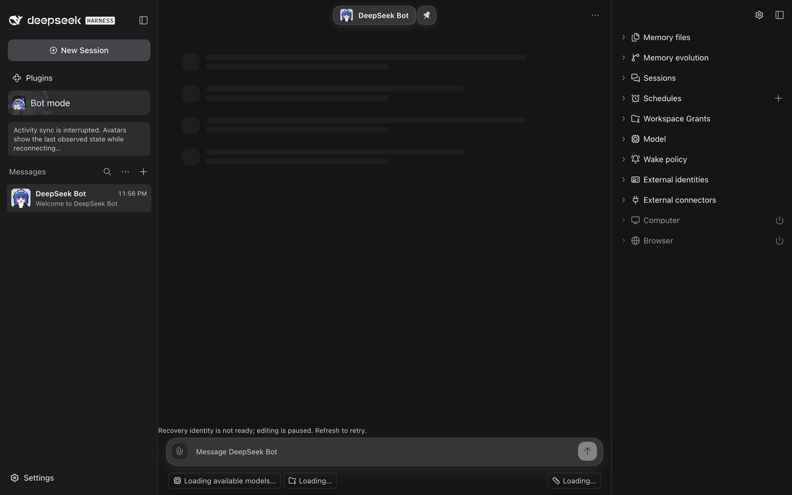

# Local RC2 multi-tab qualification — 2026-10-13

This retained local-probe report is published by an evidence-only follow-up; it does not change this branch's dependency pins. See [the continuation handoff](handoff.md) for the fetchable branch and private reconstruction boundary.

## Exact scope

- Product baseline: published PR #1467 head `66458b48eea03e8f94f014dd921d2dc3d725739c`.
- Disposable detached worktree: dependency-only RC1 → RC2 changes, regenerated lockfile, no sibling PR #1454 transport changes.
- Installed CLI: `0.2.0-rc.2`; npm `latest` and `next` both returned this version. `alpha` returned `0.2.1-alpha.2`, not a newer RC.
- Separate fresh local Profile; no production or original QA Profile changes. No new model messages, permission changes, deletion, commit, push, merge, or deployment.
- This is local compatibility/diagnosis, **not** a formal repository-wide or globally installed DSH upgrade.

## Compatibility results

- Install, typecheck, and build passed.
- Six focused files / **53 tests passed**: composer draft store/recovery, mobile Bot panel, messaging defaults live, Channel live, and Client bundle.
- No RC2 full-suite, lint, CI, real model-reply, or Human-QA qualification is claimed.
- Single-page authenticated shell and Bot DM loaded; an unsent draft survived navigation/reload and remained editable. No sending action was used.

## Browser differential loop

T3 collaborative browser, two same-origin pages, same fresh Profile and published product code. Open page A in Bot mode and leave an unsent DM draft; open page B at the same origin. Run this read-only probe through `preview_evaluate` on the selected page:

```js
(async () => {
  const started = performance.now();
  try {
    const response = await fetch('/api/botharness/list', {
      method: 'POST',
      signal: AbortSignal.timeout(5000),
      headers: { 'content-type': 'application/json' },
      body: JSON.stringify({
        type: 'client-request',
        rpcId: crypto.randomUUID(),
        method: 'botharness/list',
        payload: { args: {} },
      }),
    });
    return { ms: Math.round(performance.now() - started), status: response.status };
  } catch (error) {
    return { ms: Math.round(performance.now() - started), error: error.name };
  }
})();
```

| Condition                                                     | Observed result                                                                          |
| ------------------------------------------------------------- | ---------------------------------------------------------------------------------------- |
| RC2, one page before opening peer                             | `200`, `ok:true`, 24 ms; editor enabled                                                  |
| RC2, first two-page attempt                                   | Peer `TimeoutError`, 5002 ms; original page also 5002 ms                                 |
| RC2, instrumented two-page cycle 1                            | Peer `TimeoutError`, 5002 ms; recovery identity paused, models/messages/metadata loading |
| Leave peer page, no Host restart or credential change         | Original page `200`, 4 ms; unsent draft present, editor enabled                          |
| Reopen peer, instrumented cycle 2                             | `TimeoutError`, 5001 ms; same visible loading failure                                    |
| Independent authenticated Node request during cycle 2 failure | `200`, `ok:true`, 43 ms including login exchange                                         |
| Leave peer again, no Host restart or credential change        | Original page `200`, 8 ms; unsent draft present, editor enabled                          |



## Transport evidence and inference

An external, task-local Node preload observed incoming HTTP requests and response finish/close events. It recorded only endpoint categories, HTTP version, socket identity, status, and timestamps; no request bodies, credentials, Channel/Bot identities, or URL tokens. It did not intercept routes, change responses, disable streams, or provide an alternate authorization path. The task-owned RC2 Host was restarted solely to load this observer, then the repeated failing/recovery cycles used that same Host.

During both instrumented failures, **six simultaneous HTTP/1.1 long-lived responses** were observed on six distinct TCP connections: native HMR ×2, application roster ×2, application Channel ×1, Companion ×1. This is a measured response inventory, not the earlier speculative `three streams × two pages` arithmetic. Activity sync also reported interruption; source-site inventory is not proof that its stream acquired a slot. Native WebSocket connections are not included in this six-response count.

When the peer left, its roster/HMR responses closed and the original page's timed RPC recovered immediately. An independent authenticated request remained fast while browser requests timed out. Together these observations strongly isolate **the tested browser's per-origin HTTP/1.1 connection pressure from long-lived SSE responses**, rather than Host compute/data loading or an expired token, as the cause of this reproduction. This does not establish every loading failure in all browsers has the same cause.

The identity warning is a downstream consequence of recovery metadata being unable to load; it is not evidence that login token validation failed. Earlier unauthenticated RC1 `401` and initial/repeated diagnostics `ERR_ABORTED` remain separate evidence, not a clean-console claim.

## Similar failure surfaces and remaining gate

- Models, message history, identity recovery, sidebar metadata, activity refresh, and diagnostic POSTs can all stall/abort behind the same connection pressure. More retries or longer loading deadlines do not create request capacity.
- An observed Host restart restored native transport/read-only RPC but left an already failed message view requiring reload. This is a separate recovery follow-up, not yet a minimized independently qualified bug.
- RC2 alone **does not unblock multi-tab draft conflict acceptance**. Do not mark #1459 complete or infer a fix from successful single-page compatibility.
- Coordinate transport work with #1451 / PR #1454's owner. Its partial consolidation must account for Companion and native HMR, or qualify a native multiplexed transport. Do not silently disable live updates as the product fix.
- Re-run this red-capable two-page loop against an exact transport-fix head, then complete real draft-conflict selection and remaining Human QA. No merge/deployment or sibling takeover occurs here.
- At the end of this run, the peer was navigated away and the single DM page was usable; its unsent draft remained intact. Temporary observer removed from the running Host after evidence collection.
