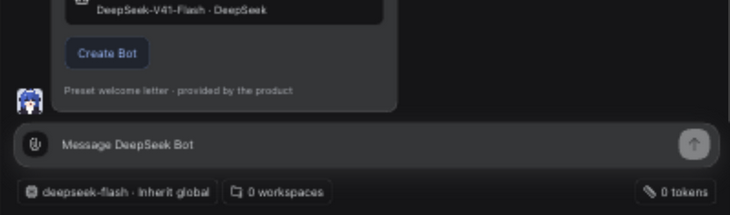
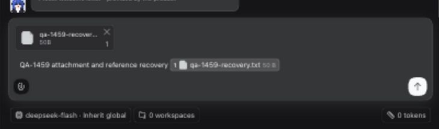
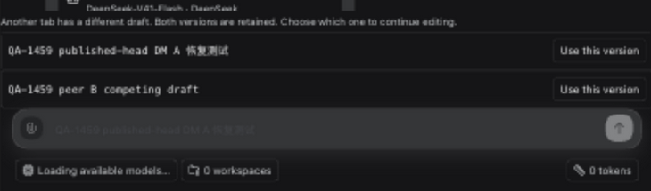
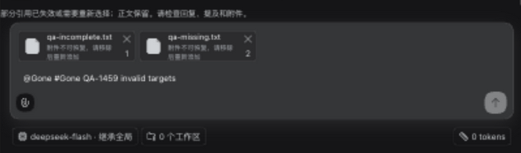
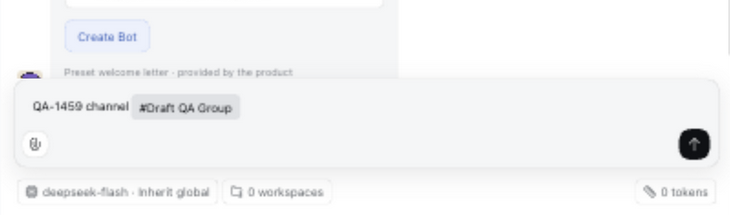
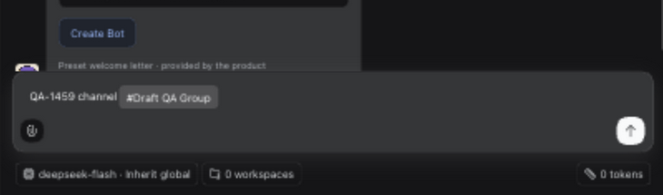

# Composer draft acceptance follow-up

Issue: [#1459](https://github.com/BotHarness/DeepSeekBot/issues/1459). Draft PR: [#1467](https://github.com/BotHarness/DeepSeekBot/pull/1467). Task: `codex/local/01a12f41-fe63-71b1-b649-520c0236079b` (not a DSH Session).

Date: 2026-10-12. Runtime source head: `4fb172eefd16c27aa0071b875462d345419d4aa1`. Comparison baseline: `1b6948b469097fad7ab527bb08dd89ab9598172f`. Both use the isolated pinned DSH `0.2.0-rc.1` launcher. This evidence follow-up does not change runtime source.

## Observed runtime paths

| Path                          | Evidence and limit                                                                                                                                                                                                                                                                                                                                                                                                                                                                                                                                                               |
| ----------------------------- | -------------------------------------------------------------------------------------------------------------------------------------------------------------------------------------------------------------------------------------------------------------------------------------------------------------------------------------------------------------------------------------------------------------------------------------------------------------------------------------------------------------------------------------------------------------------------------- |
| Two DM Channels and one Group | Distinct drafts survive switching. Group survives reload. DM A survives actual closure of both task Preview tabs and reopening a new tab.                                                                                                                                                                                                                                                                                                                                                                                                                                        |
| Two-tab conflict              | With A's composer focused, B edits the same Channel. A retains its text and shows both versions with explicit selection buttons. Selecting B leaves one durable head and its selected text. Completion of canonical validation requires exiting Bot mode in the peer tab under the observed connection pressure; uninterrupted two-tab readiness is **not qualified**. No storage-event interception was used for this successful conflict reproduction.                                                                                                                         |
| Uploaded attachment           | A synthetic 50-byte text file goes through the real file-input upload path. After reload its canonical reference and inline chip restore with `data-status=ready`; the composer is editable. No message is submitted.                                                                                                                                                                                                                                                                                                                                                            |
| Mention and Channel reference | Select real roster and Channel options in the composer. Reload restores the selected Bot token and Group token, respectively. These were separate runs.                                                                                                                                                                                                                                                                                                                                                                                                                          |
| Stale references              | A browser-storage fixture includes a missing Bot, missing Channel, missing reply, incomplete upload and a validly shaped missing attachment ID. Normal Host validation removes unavailable mention/Channel/reply targets, preserves text, and shows Chinese warnings and non-ready attachment chips. This is **fixture-assisted negative-path evidence**, not a real deletion/revocation flow or proof of a valid reply round trip. The first fixture had an invalid attachment ID and correctly produced the corrupt-record warning; the corrected fixture is the one captured. |
| Quota error                   | Task-only `Storage.setItem` fault injection rejects composer writes. In-memory text remains visible, the prior durable text is unchanged, and an explicit copy-backup warning appears. The prototype override is removed afterward.                                                                                                                                                                                                                                                                                                                                              |
| Corrupt record                | Replace one task draft with malformed JSON, reload, and observe the storage warning. Restore the original record and reload: the original text returns with no alert.                                                                                                                                                                                                                                                                                                                                                                                                            |
| Slash and Companion           | Slash opens the existing model/workspace/Companion options; Escape closes the menu. Toggling Companion on and off preserves the unsent text. This does not qualify command execution or welcome chips that send messages.                                                                                                                                                                                                                                                                                                                                                        |
| Locale and theme              | Chinese and English application labels render without losing the draft. Light and dark captures show a restored Channel chip. Original English locale is restored.                                                                                                                                                                                                                                                                                                                                                                                                               |
| Unsent authority              | After these runs, the isolated canonical database still has two pre-existing welcome Source Events, zero Session ownership rows and zero Bot wake attempts. No test message or schedule was submitted. Temporary fault globals and session backup keys are absent after cleanup. This count is not a general telemetry audit.                                                                                                                                                                                                                                                    |

## Comparable captures

Both baseline and changed UI use English, dark appearance, the same text and synthetic attachment filename/content, and the same measured **1402 × 877 CSS-pixel** desktop viewport. T3 emits **1280 × 800** screenshots; these are matching **730 × 215** crops from those rescaled captures, not a claim that the CSS viewport is 1280 × 800. Separate isolated Profiles have different welcome timestamps; unrelated roster and sidebar contents are cropped out.

Before: type the draft, upload the file, then reload the baseline. Text and selected attachment context are absent.

After: the same unsent text and actual uploaded reference survive reload.

The baseline has no recovery conflict selector or stale-reference warning; its after-reload absence state is the predecessor for these added recovery surfaces.

## Automated checks and remaining gates

- Focused store/recovery/mobile coverage: **34 passed** across three files. Typecheck, lint, formatting, build and whitespace checks pass for the runtime fix.
- New runtime-head full suite: **4222 passed, 13 skipped, 1 failed** across 505 files. The remaining synthetic-stdin wizard exit-status failure is the same previously reproduced baseline failure; the full suite is **not green**.
- The prior-head Actions verify run passed. At runtime-head readback, only CodeRabbit's “review skipped: draft” status is present; no new-head Actions verify result is claimed.
- Narrow viewport changes time out for both preset and freeform requests. DOM width remains 1402, so narrow/mobile acceptance is **blocked**, not inferred from screenshot dimensions. No alternate browser or permission bypass was used.
- Still required: uninterrupted dual-tab recovery validation, a valid reply round trip and real revocation/deletion paths, native IME interaction, sending welcome-chip behavior, narrow UI acceptance, new-head required CI, and Human QA. Identity-isolation unit coverage is not a second-Host live qualification.
- Keep the PR Draft. Do not merge, deploy, start dependent issues, or mark all acceptance criteria complete from these partial results.

## Runnable review

Launch this branch with the repository's isolated launcher and use its locally printed login URL. Create two disposable Bots and one Group; type different drafts without sending, switch, reload, close and reopen. For conflict review, initialize both tabs, focus A's existing composer, then replace the text in B. A must retain its local text and offer both versions. Select a version and confirm canonical validation finishes without requiring the peer to leave Bot mode on the Human's target browser setup. Upload a synthetic file through the real composer, reload, and inspect its restored chip. Complete reply, revocation, IME, narrow viewport and welcome-chip checks separately, preserving the no-unsent-wake boundary before any deliberate send test.
