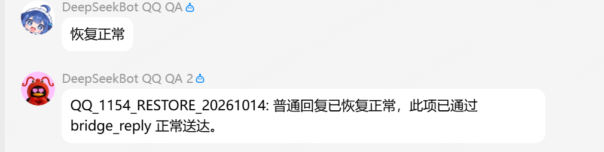

# QQ delayed-result native qualification — 2026-10-14

Task: `codex/local/01a13902-0d72-7872-ac0f-440e152155d5` · [#1154](https://github.com/BotHarness/DeepSeekBot/issues/1154) · [draft PR #1647](https://github.com/BotHarness/DeepSeekBot/pull/1647)

The QA2 application completed a genuine QQ-requested delayed task through the checked production path. The Human confirmed one correct result in the original QQ group. This qualifies that application's tested behavior; it does not establish eligibility for every application or qualify ordinary-group participation.

## Candidate and authority

- Implementation revision: `0df23253faceacec858b0ff78464a2daeec32be1`.
- DSH: `0.2.0-rc.2`, isolated Windows Web Profile, real `opencode-go / deepseek-v4-flash` model.
- Provider: qualified immutable source `0e5b447f45e4a44d4089eac16cc1fa5673dbd66d`, corresponding to the existing `.20` Provider. No Provider source change was needed for this slice.
- The Human selected QA2, confirmed proactive/full-message permissions, and authorized a temporary stop of the original local dual-App receiver plus exact restoration. No receiver claim, original configuration or original credential store was replaced.
- The task authorized a saved target for QA2's existing application-scoped original group. Receiving an @mention did not supply proactive authority.

## Actual delayed behavior

The real request marker was `QQ_1154_DELAY_20261014_C`. Its Source timestamp was **07:56:33 UTC**. The Bot created a one-time Schedule for **08:03 UTC**, preserving the actual trusted Source Event ID.

| Fact                                  | Observed result                                                                                                                                                  |
| ------------------------------------- | ---------------------------------------------------------------------------------------------------------------------------------------------------------------- |
| Original source reply                 | At 08:03:05.063 UTC, a source-bound Outbox intent retained `QQ_1154_DELAY_20261014_C_RESULT_221` as `failed / reply-window-expired`; no receipt or false success |
| Independent proactive action          | At 08:03:13.542 UTC, a distinct Outbox intent used the owned saved grant and a stable independent request ID                                                     |
| Destination and native correspondence | `provider-accepted`, native receipt version 1; receipt and report conversation matched QA2's own original group                                                  |
| Delay                                 | 400.542 seconds between the Source timestamp and proactive intent creation; no clock manipulation                                                                |
| QQ rendering                          | Human confirmed the correct result appeared exactly once, with no earlier confirmation or repeated result                                                        |
| Result placement                      | No implicit Web Human-DM result mirror; the reply failure and independent report remain distinct canonical records                                               |

An earlier real Schedule, marker A, correctly retained its expired reply but could not select a post: the model-facing `bridge_targets` projection omitted `canPost` and the exact conversation. The defect was fixed and covered through the real Orchestrator seam before C was tested. Its failure remains recorded. Marker B reached the restored original receiver and is excluded from candidate qualification; its original state was preserved.

## Real refusal and restoration

A separate proactive permission check reached QQ and the Human confirmed its contents. For a refused case, the task-owned Bot's shared hourly post limit was temporarily set to an already exhausted value through the normal Owner API. The attempted new report became `failed / post-rate-limited` with retained content and no native receipt. Its original limit was restored and read back. This is a real Host-policy refusal, not a QQ-side permission rejection.

After each receiver window, the test Host and port were verified stopped. The original Host was relaunched using its captured executable and arguments. Its authenticated native API reported **two configured, two connected** Apps, and the original receiver registry hash remained unchanged. After the final restoration, the Human supplied a real QQ screenshot showing fresh normal replies from both QA1 and QA2. The VPS receiver stayed in its original stopped state.

_Human-provided actual QQ capture, cropped to the two test Apps' replies. Fresh Sources at 08:08:55 and 08:08:57 UTC each correlated with their own restored account and a source-bound `provider-accepted` native receipt. This image verifies restoration; it is not a screenshot of the delayed C result._

## Checks and remaining qualification

- QQ public-seam regressions: **13/13 passed**, including actual Orchestrator target metadata, expired/in-window replies, native refusals, unknown recovery and final revocation.
- Native Tool adapter ownership regression: **1 passed**, 29 unselected.
- Typecheck, lint, formatting, build and bilingual ledger checks passed. Full Linux CI passed for the implementation revision ([run](https://github.com/BotHarness/DeepSeekBot/actions/runs/38529585646)). The overloaded parallel Windows full suite was stopped after numerous timeouts; local full-suite success is not claimed.
- Local product archives `1.3.0-test.1154.3` were packed with integrity metadata and the unchanged `.20` Provider. They were not published. This real QQ run used the rebuilt worktree Host; native execution of the final packed product remains a separate gate.
- The Human's C rendering confirmation and restoration screenshot are distinct evidence. Matched QQ/Client before-and-after screenshots and reviewer-accessible HTML still remain review gaps. The draft PR stays open; no issue closure, merge or deployment is claimed.
- #1155 ordinary-message ingress and intentional participation require their own fresh non-mentioned event on the candidate receiver and explicit per-conversation collection. C does not qualify them.

Private process evidence retains the canonical Source, Schedule firing, Outbox records, native Session events and restore guards. Public records omit private group/member identifiers, credentials, login URLs and unrelated chat.
